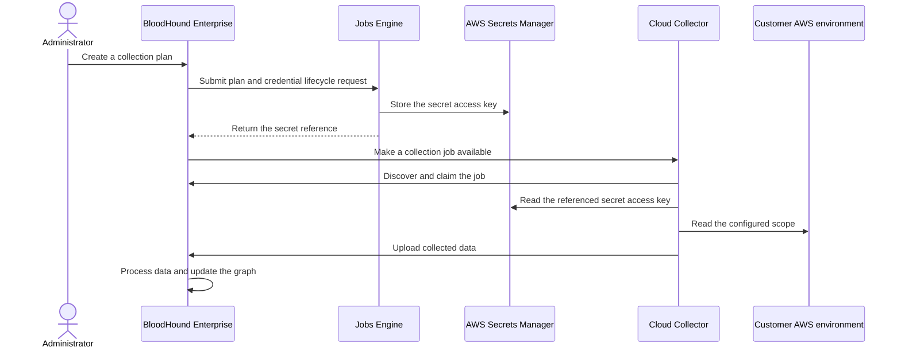

import CloudCollectorBetaNote from '/snippets/feature-beta.mdx';


<CloudCollectorBetaNote feature="Cloud Collector" />

Cloud Collector reduces the infrastructure you operate for AWS organization collection, but your organization remains responsible for granting collection permissions and protecting the credential you provide.

This page describes the beta credential and data-handling model. BloodHound Enterprise submits the collection plan and its related records, while Cloud Collector processes collection jobs outside of BloodHound Enterprise.

## Understand the security model

The following sequence shows how BloodHound Enterprise, the jobs engine, Cloud Collector, AWS Secrets Manager, and your AWS environment interact during collection:



<Note>
  Collection reads AWS metadata and does not modify your organization or account resources. Your administrator creates the IAM principal, roles, policies, and trust relationships needed for collection.
</Note>

## Protect AWS credentials

Each collection plan uses one AWS access key pair, either newly supplied or selected from a saved credential:

- **Access Key ID** identifies the AWS credential
- **Secret Access Key** authenticates the credential

When you save a new credential, BloodHound Enterprise sends the secret access key to AWS Secrets Manager and stores its reference and access key ID. The collector jobs database stores this metadata, not the secret access key.

BloodHound Enterprise does not read the secret access key back or display it after saving. Cloud Collector obtains the access key ID from the job and retrieves the referenced secret access key.

BloodHound Enterprise handles customer-secret lifecycle requests, while Cloud Collector retrieves the secret for collection rather than creating or updating it. In this beta, you cannot edit a collection plan and select a different saved credential after saving it, and you cannot edit the saved key pair itself.

The Cloud Collector user interface does not provide a self-service way to delete credential reference metadata from the Cloud Collector service. Contact your SpecterOps account team for more information.

The **Configuration** field is for non-secret collection settings. Do not paste AWS keys, BloodHound Enterprise tokens, or other credential material into the JSON configuration. Configuration is retained with plan and job records, including history. Use the separate **Secrets** section for the AWS access key pair.

<Warning>
  Treat the secret access key as a long-lived credential. Do not reuse it for unrelated workloads, commit it to source control, or include it in screenshots, logs, or support requests.
</Warning>

## Rotate or revoke a credential

To rotate a credential, follow [Rotate a credential](/collect-data/enterprise-collection/cloud-collector/configure#rotate-a-credential). That procedure covers creating and validating a replacement plan, revoking the old AWS key, and removing the old secret reference through the supported process.

Deleting the old plan removes its profile and schedule links; it does not automatically delete the secret reference or revoke the AWS key. Secret deletion is a separate operation that detaches referencing profiles. A job that BloodHound Enterprise already created keeps its captured key reference, but it can fail if the underlying AWS key is revoked.

## Apply least privilege in AWS

Use a dedicated starting principal with permission to assume the required roles, rather than granting it administrator access. Grant the collection roles only the read-only permissions required for collection.

Review the scope whenever you change the AWS policy. A policy that is too narrow can produce failed or incomplete collection; a policy that is broader than necessary increases the impact of a compromised credential.

### Configure AWS permissions

An AWS administrator must configure the following before you create the plan. The starting user may be in the management account or another account. Do not use Cloud Collector's infrastructure identity as a principal in these customer role trust policies.

The examples use:

| Example value | Meaning |
| --- | --- |
| `111111111111` | AWS Organizations management account ID |
| `222222222222` | Account that owns the starting IAM user; replace it with the actual account, including management if applicable |
| `333333333333` | An example active member account; add every active member account to the member assumption policy |
| `OpenHoundCollectorUser` | Dedicated IAM user whose access key pair you supply |
| `OpenHoundManagementRole` | Management role used for survey, Organizations data, and management-account collection |
| `OpenHoundCollectorRole` | Collection role with the same name in every active member account |

These are IAM policies to configure in AWS, **not** objects to paste into the collection plan's **Configuration** field.

<Steps>
  <Step title="Create or identify the starting IAM user">
    Create a dedicated IAM user, or identify an existing dedicated user, and provision an access key pair according to your organization's credential policy. Keep the secret access key private and enter the pair only in the collection plan's **Secrets** step.

    Record the user's IAM ARN. Replace `arn:aws:iam::222222222222:user/OpenHoundCollectorUser` throughout the following trust policies with that ARN.
  </Step>
  <Step title="Create the management and member roles">
    In the management account, create or identify `OpenHoundManagementRole`. Its trust policy must allow the starting user to assume it:

    ```json
    {
      "Version": "2012-10-17",
      "Statement": [
        {
          "Effect": "Allow",
          "Principal": {
            "AWS": "arn:aws:iam::222222222222:user/OpenHoundCollectorUser"
          },
          "Action": "sts:AssumeRole"
        }
      ]
    }
    ```

    In every active member account, create or identify `OpenHoundCollectorRole`. Select its trust policy according to the plan's `member_role_source` value:

    <Tabs>
      <Tab title="source">
        Member roles trust the starting user directly:

        ```json
        {
          "Version": "2012-10-17",
          "Statement": [
            {
              "Effect": "Allow",
              "Principal": {
                "AWS": "arn:aws:iam::222222222222:user/OpenHoundCollectorUser"
              },
              "Action": "sts:AssumeRole"
            }
          ]
        }
        ```
      </Tab>
      <Tab title="management">
        Member roles trust the management role:

        ```json
        {
          "Version": "2012-10-17",
          "Statement": [
            {
              "Effect": "Allow",
              "Principal": {
                "AWS": "arn:aws:iam::111111111111:role/OpenHoundManagementRole"
              },
              "Action": "sts:AssumeRole"
            }
          ]
        }
        ```
      </Tab>
    </Tabs>

    Use your normal IAM role deployment process to cover all active members. If the starting user's account is an active member, it also needs the member collection role. The management account uses its management role instead.
  </Step>
  <Step title="Allow the calling identities to assume the roles">
    Attach this identity policy to the starting user for **both** member-role paths:

    ```json
    {
      "Version": "2012-10-17",
      "Statement": [
        {
          "Effect": "Allow",
          "Action": "sts:AssumeRole",
          "Resource": "arn:aws:iam::111111111111:role/OpenHoundManagementRole"
        }
      ]
    }
    ```

    Also grant permission to assume the member roles. Attach the following policy to the **starting user** for `source`, or to **OpenHoundManagementRole** for `management`. Replace the example member ARN and add one ARN for every active member account:

    ```json
    {
      "Version": "2012-10-17",
      "Statement": [
        {
          "Effect": "Allow",
          "Action": "sts:AssumeRole",
          "Resource": [
            "arn:aws:iam::333333333333:role/OpenHoundCollectorRole"
          ]
        }
      ]
    }
    ```

    Both an identity's assume-role permissions and the target role's trust must permit the chosen path. Service control policies, permission boundaries, and other explicit denies can still block access. This policy does not filter survey discovery: the collector still discovers all active organization accounts.
  </Step>
  <Step title="Grant read-only collection permissions">
    Attach the following account-read policy to `OpenHoundManagementRole` and to `OpenHoundCollectorRole` in each active member account:

    ```json
    {
      "Version": "2012-10-17",
      "Statement": [
        {
          "Effect": "Allow",
          "Action": [
            "sts:GetCallerIdentity",
            "ec2:DescribeRegions",
            "ec2:DescribeInstances",
            "iam:GetAccountAuthorizationDetails",
            "iam:ListSAMLProviders",
            "iam:ListOpenIDConnectProviders",
            "iam:GetSAMLProvider",
            "iam:GetOpenIDConnectProvider",
            "s3:ListAllMyBuckets",
            "s3:GetBucketLocation",
            "s3:GetBucketPolicy",
            "s3:GetBucketPolicyStatus",
            "s3:GetBucketAcl",
            "s3:GetBucketPublicAccessBlock",
            "s3:GetAccountPublicAccessBlock",
            "s3:GetBucketOwnershipControls",
            "s3:GetBucketTagging",
            "s3:ListBucket",
            "kms:ListKeys",
            "kms:DescribeKey",
            "kms:GetKeyPolicy",
            "kms:GetKeyRotationStatus",
            "kms:ListGrants",
            "kms:ListAliases",
            "kms:ListResourceTags",
            "ssm:DescribeParameters",
            "ssm:DescribeInstanceInformation",
            "ssm:ListTagsForResource",
            "lambda:ListFunctions",
            "lambda:GetPolicy",
            "lambda:GetFunctionUrlConfig",
            "lambda:ListTags",
            "cloudformation:DescribeStacks",
            "cloudformation:ListStackResources",
            "cloudformation:ListStacks",
            "cloudformation:ListStackSets",
            "cloudformation:DescribeStackSet",
            "eks:ListClusters",
            "eks:DescribeCluster",
            "eks:ListNodegroups",
            "eks:DescribeNodegroup",
            "eks:ListAccessEntries",
            "eks:DescribeAccessEntry",
            "eks:ListAssociatedAccessPolicies",
            "eks:ListPodIdentityAssociations",
            "eks:DescribePodIdentityAssociation"
          ],
          "Resource": "*"
        }
      ]
    }
    ```

    This policy includes optional S3 bucket and object inventory. If you disable that inventory, you can omit the other `s3:` actions, but retain `s3:GetAccountPublicAccessBlock` for account-level settings. Collection does not retrieve object contents, parameter values, or plaintext key material, so do not grant `s3:GetObject`, `ssm:GetParameter`, or `kms:Decrypt` for those purposes.

    <Note>
      For customer managed KMS keys, the key policy must permit the collection role's required read actions, either directly or by enabling delegation through IAM policies. Attaching the IAM policy above does not by itself guarantee access to every key.
    </Note>

    Attach this additional Organizations policy to **OpenHoundManagementRole only**:

    ```json
    {
      "Version": "2012-10-17",
      "Statement": [
        {
          "Effect": "Allow",
          "Action": [
            "organizations:DescribeOrganization",
            "organizations:ListRoots",
            "organizations:ListChildren",
            "organizations:ListOrganizationalUnitsForParent",
            "organizations:ListAccountsForParent",
            "organizations:ListAccounts",
            "organizations:ListPolicies",
            "organizations:DescribePolicy",
            "organizations:ListTargetsForPolicy"
          ],
          "Resource": "*"
        }
      ]
    }
    ```

    The starting user does not need Organizations read access when it assumes this management role. Use these role names, the management account ID, and the matching member-role path in the plan's [AWS configuration](/collect-data/enterprise-collection/cloud-collector/configure#aws-configuration).
  </Step>
</Steps>

Confirm account coverage after collection. A successful survey does not prove that every member role can be assumed, and a successful job can still omit inaccessible accounts or attributes.

## Understand extension scope

The AWS extension is the first Cloud Collector target. The architecture is designed for additional extensions, but the beta scope is limited to the AWS extension. Contact your SpecterOps account team for current extension and capability details.

The beta supports AWS organization survey and collection using either member-role path described above. It does not accept customer-provided AWS files or named profiles, and it does not support single-account, independent-account, or custom finished-config workflows. See [AWS collection scope](/collect-data/enterprise-collection/cloud-collector/configure#aws-collection-scope).

## Allow Cloud Collector traffic

If your AWS or network controls require source allowlisting, request the current Cloud Collector network requirements and change-notification process from your SpecterOps account team. Do not infer the range from a self-deployed collector's address.

{/* TODO: Document the Cloud Collector egress IP range and allowlisting requirements when available. */}

## Understand logs and diagnostics

BloodHound Enterprise displays basic collection errors and plan results. Secret creation and deletion are logged for operational auditing.

Diagnostic retention and access to Cloud Collector logs vary by support arrangement. Contact your SpecterOps account team for current support procedures.

## Protect collected data

Cloud Collector uploads collected data to your BloodHound Enterprise tenant for processing and graph analysis. BloodHound Enterprise's normal data retention and deletion controls apply to the ingested graph data. Review [Data reconciliation and retention](/collect-data/enterprise-collection/data-retention) for those controls.

Cloud Collector job history is self-contained and separate from graph data. It contains job metadata and outcome details, not the AWS secret value. View it from a collection plan's **History** drawer.

<Note>
  Cloud Collector jobs are not recorded on the **Administration** > **Manage Clients** or **Administration** > **Finished Jobs Log** pages. Job history is immutable and retained for 90 days. This retention period is not configurable.
</Note>

## Understand tenant isolation

Cloud Collector credentials use tenant-scoped secret storage and Identity and Access Management (IAM) controls according to the deployment configuration. Your tenant cannot access other tenants' secrets, and other tenants cannot access yours.

BloodHound Enterprise and the jobs engine manage the credential lifecycle, while the collector reads the credential to perform collection. The security design targets zero cross-tenant secret access and removal of orphaned secrets as operational outcomes.

Deleting a collection plan does not automatically remove its stored credential. Follow the [credential cleanup process](#rotate-or-revoke-a-credential), and request current tenant-isolation and secret-lifecycle details from your SpecterOps account team for a security review.

## Customer responsibilities

Your organization is responsible for:

- Granting the required role-assumption permissions and trust, with read-only permissions on collection roles.
- Protecting and rotating the AWS access key pair according to your credential policy.
- Deleting unused collection plans and disabling unused AWS keys.
- Reviewing collection scope and results for unexpected access or missing resources.
- Sending only non-secret diagnostic information through approved support channels.

## Request security-review materials

Contact your SpecterOps account team for current security-review materials before completing an IT governance or risk assessment.

Available materials may include security architecture details, penetration-test summaries, egress requirements, and subprocessor information. The availability and contents of these materials can change during the beta.

## Next steps

- [Configure a collection plan](/collect-data/enterprise-collection/cloud-collector/configure)
- [Troubleshoot Cloud Collector](/collect-data/enterprise-collection/cloud-collector/troubleshoot)
