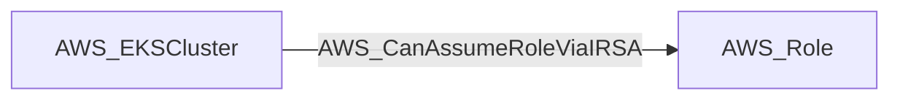

import AwsReferenceBetaNote from '/snippets/opengraph/extensions/aws-reference-beta-note.mdx';

<AwsReferenceBetaNote />

Data-derived edge from an EKS cluster to an IAM role whose trust policy references the cluster's OIDC provider (IAM Roles for Service Accounts). Traversable because a Kubernetes admin can run a pod using the annotated service account, and the IRSA webhook injects the role's web-identity credentials into the pod.

## Edge Schema

- Source: [AWS_EKSCluster](/opengraph/extensions/aws/nodes/aws_ekscluster)
- Destination: [AWS_Role](/opengraph/extensions/aws/nodes/aws_role)
- Traversable: ✅

BloodHound can include this relationship in an Attack Path.

### Endpoint pairs

| Source Node Types | Destination Node Types |
| --- | --- |
| [AWS_EKSCluster](/opengraph/extensions/aws/nodes/aws_ekscluster) | [AWS_Role](/opengraph/extensions/aws/nodes/aws_role) |

## Diagram

## Interpretation

The collector matches the cluster OIDC issuer to a role trust statement. `irsa_subject`, `irsa_subject_operator`, `irsa_audience`, and `is_scoped` preserve service-account scope; review them before applying this cluster-level capability to a workload.

[AWS schema](/opengraph/extensions/aws/schema)
