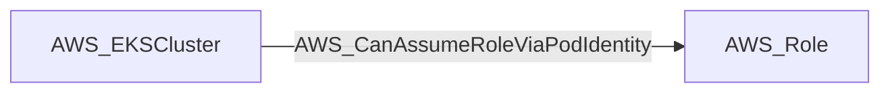

import AwsReferenceBetaNote from '/snippets/opengraph/extensions/aws-reference-beta-note.mdx';

<AwsReferenceBetaNote />

Data-derived edge from an EKS cluster to an IAM role mapped via an EKS Pod Identity association. Traversable because a Kubernetes admin can run a pod using the mapped service account, and the EKS Pod Identity Agent injects the role's credentials automatically.

## Edge Schema

- Source: [AWS_EKSCluster](/opengraph/extensions/aws/nodes/aws_ekscluster)
- Destination: [AWS_Role](/opengraph/extensions/aws/nodes/aws_role)
- Traversable: ✅

BloodHound can include this relationship in an Attack Path.

### Endpoint pairs

| Source Node Types | Destination Node Types |
| --- | --- |
| [AWS_EKSCluster](/opengraph/extensions/aws/nodes/aws_ekscluster) | [AWS_Role](/opengraph/extensions/aws/nodes/aws_role) |

## Diagram

## Interpretation

The collector derives this edge from a collected Pod Identity association with a known cluster ARN and destination role. The relationship summarizes the association at cluster scope.

[AWS schema](/opengraph/extensions/aws/schema)
