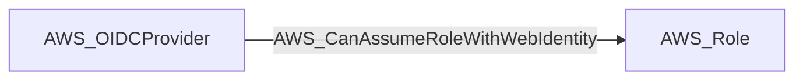

import AwsReferenceBetaNote from '/snippets/opengraph/extensions/aws-reference-beta-note.mdx';

<AwsReferenceBetaNote />

Principal can call sts:AssumeRoleWithWebIdentity to assume a role via OIDC federation.

## Edge Schema

- Source: [AWS_OIDCProvider](/opengraph/extensions/aws/nodes/aws_oidcprovider)
- Destination: [AWS_Role](/opengraph/extensions/aws/nodes/aws_role)
- Traversable: ✅

BloodHound can include this relationship in an Attack Path.

### Endpoint pairs

| Source Node Types | Destination Node Types |
| --- | --- |
| [AWS_OIDCProvider](/opengraph/extensions/aws/nodes/aws_oidcprovider) | [AWS_Role](/opengraph/extensions/aws/nodes/aws_role) |

## Diagram

## Interpretation

The source is the OIDC provider trusted by the role. The collector derives this direction from a same-account federated trust statement allowing `sts:AssumeRoleWithWebIdentity`. Trust conditions remain on the assumption edge; access depends on the token and its claims.

## Authorization evidence

Associated API action: `sts:AssumeRoleWithWebIdentity`.

## Evaluation limits

This edge represents the collector's model of collected authorization and resource state. It does not prove that every runtime request succeeds. Inspect unresolved `conditions` and `trust_policy_conditions` when present; `has_conditions` and `has_trust_policy_conditions` indicate retained evidence. Composite edges can include `methods` or `composite_components` describing their derivation.

[AWS schema](/opengraph/extensions/aws/schema)
