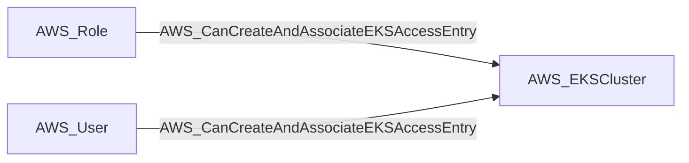

import AwsReferenceBetaNote from '/snippets/opengraph/extensions/aws-reference-beta-note.mdx';

<AwsReferenceBetaNote />

Can Create And Associate EKS Access Entry relationship.

## Edge Schema

- Source: [AWS_Role](/opengraph/extensions/aws/nodes/aws_role), [AWS_User](/opengraph/extensions/aws/nodes/aws_user)
- Destination: [AWS_EKSCluster](/opengraph/extensions/aws/nodes/aws_ekscluster)
- Traversable: ✅

BloodHound can include this relationship in an Attack Path.

### Endpoint pairs

| Source Node Types | Destination Node Types |
| --- | --- |
| [AWS_Role](/opengraph/extensions/aws/nodes/aws_role) | [AWS_EKSCluster](/opengraph/extensions/aws/nodes/aws_ekscluster) |
| [AWS_User](/opengraph/extensions/aws/nodes/aws_user) | [AWS_EKSCluster](/opengraph/extensions/aws/nodes/aws_ekscluster) |

## Diagram

## Interpretation

The collector combines `eks:CreateAccessEntry` and `eks:AssociateAccessPolicy` for the same collected cluster in the same account. Authorization also uses a representative access-entry ARN. `authorization_targets` and `authorization_actions` retain this distinction from the cluster graph endpoint.

## Evaluation limits

This edge represents the collector's model of collected authorization and resource state. It does not prove that every runtime request succeeds. Inspect unresolved `conditions` and `trust_policy_conditions` when present; `has_conditions` and `has_trust_policy_conditions` indicate retained evidence. Composite edges can include `methods` or `composite_components` describing their derivation.

[AWS schema](/opengraph/extensions/aws/schema)
