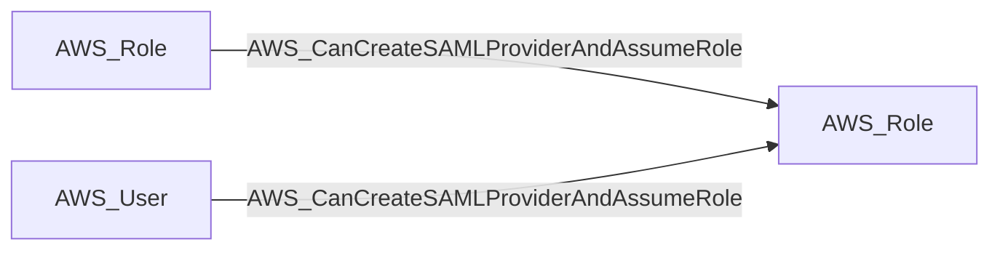

import AwsReferenceBetaNote from '/snippets/opengraph/extensions/aws-reference-beta-note.mdx';

<AwsReferenceBetaNote />

Principal can create a malicious SAML identity provider and rewrite a role's trust policy to trust it, then assume the role via sts:AssumeRoleWithSAML using assertions from the attacker-controlled provider.

## Edge Schema

- Source: [AWS_Role](/opengraph/extensions/aws/nodes/aws_role), [AWS_User](/opengraph/extensions/aws/nodes/aws_user)
- Destination: [AWS_Role](/opengraph/extensions/aws/nodes/aws_role)
- Traversable: ✅

BloodHound can include this relationship in an Attack Path.

### Endpoint pairs

| Source Node Types | Destination Node Types |
| --- | --- |
| [AWS_Role](/opengraph/extensions/aws/nodes/aws_role) | [AWS_Role](/opengraph/extensions/aws/nodes/aws_role) |
| [AWS_User](/opengraph/extensions/aws/nodes/aws_user) | [AWS_Role](/opengraph/extensions/aws/nodes/aws_role) |

## Diagram

## Interpretation

The collector combines provider creation in the account with `iam:UpdateAssumeRolePolicy` on a concrete role in that account. The graph destination is that existing role. Creating a provider alone is not sufficient; the modeled path also requires a usable federated identity and satisfaction of any retained conditions.

## Evaluation limits

This edge represents the collector's model of collected authorization and resource state. It does not prove that every runtime request succeeds. Inspect unresolved `conditions` and `trust_policy_conditions` when present; `has_conditions` and `has_trust_policy_conditions` indicate retained evidence. Composite edges can include `methods` or `composite_components` describing their derivation.

[AWS schema](/opengraph/extensions/aws/schema)
