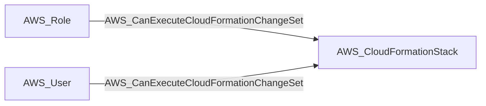

import AwsReferenceBetaNote from '/snippets/opengraph/extensions/aws-reference-beta-note.mdx';

<AwsReferenceBetaNote />

Principal can call both cloudformation:CreateChangeSet and cloudformation:ExecuteChangeSet to apply a rewritten template to an existing stack, which CloudFormation executes as the stack's execution role (no iam:PassRole needed); the compromise continues to that role via AWS_RunsAs.

## Edge Schema

- Source: [AWS_Role](/opengraph/extensions/aws/nodes/aws_role), [AWS_User](/opengraph/extensions/aws/nodes/aws_user)
- Destination: [AWS_CloudFormationStack](/opengraph/extensions/aws/nodes/aws_cloudformationstack)
- Traversable: ✅

BloodHound can include this relationship in an Attack Path.

### Endpoint pairs

| Source Node Types | Destination Node Types |
| --- | --- |
| [AWS_Role](/opengraph/extensions/aws/nodes/aws_role) | [AWS_CloudFormationStack](/opengraph/extensions/aws/nodes/aws_cloudformationstack) |
| [AWS_User](/opengraph/extensions/aws/nodes/aws_user) | [AWS_CloudFormationStack](/opengraph/extensions/aws/nodes/aws_cloudformationstack) |

## Diagram

## Composite requirements

The collector combines the following permission kinds for the same principal and target. Their presence must satisfy the collector's evaluation and resource-state checks.

- `AWS_CanCreateCloudFormationChangeSet` (internal permission evidence, not a public schema kind)
- `AWS_CanExecuteExistingCloudFormationChangeSet` (internal permission evidence, not a public schema kind)

## Evaluation limits

This edge represents the collector's model of collected authorization and resource state. It does not prove that every runtime request succeeds. Inspect unresolved `conditions` and `trust_policy_conditions` when present; `has_conditions` and `has_trust_policy_conditions` indicate retained evidence. Composite edges can include `methods` or `composite_components` describing their derivation.

[AWS schema](/opengraph/extensions/aws/schema)
