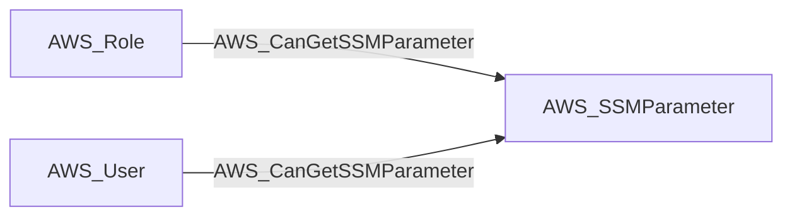

import AwsReferenceBetaNote from '/snippets/opengraph/extensions/aws-reference-beta-note.mdx';

<AwsReferenceBetaNote />

Principal can read the usable value of a same-account SSM Parameter Store parameter.

## Edge Schema

- Source: [AWS_Role](/opengraph/extensions/aws/nodes/aws_role), [AWS_User](/opengraph/extensions/aws/nodes/aws_user)
- Destination: [AWS_SSMParameter](/opengraph/extensions/aws/nodes/aws_ssmparameter)
- Traversable: ✅

The relationship represents a usable parameter read and can form an Attack Path step.

### Endpoint pairs

| Source Node Types | Destination Node Types |
| --- | --- |
| [AWS_Role](/opengraph/extensions/aws/nodes/aws_role) | [AWS_SSMParameter](/opengraph/extensions/aws/nodes/aws_ssmparameter) |
| [AWS_User](/opengraph/extensions/aws/nodes/aws_user) | [AWS_SSMParameter](/opengraph/extensions/aws/nodes/aws_ssmparameter) |

## Diagram

## Interpretation

The collector requires known parameter metadata and effective `ssm:GetParameter` authorization. For a `SecureString`, it also requires a resolved KMS key in the parameter's account and region, an `Enabled` or `Updating` key state, and effective `kms:Decrypt` authorization for the same principal in the SSM service context. Effective denies on the default AWS-managed key also suppress the relationship.

The relationship is not emitted when required parameter or key metadata is missing, the key resolves to a different account or region, or authorization is insufficient. The edge retains the SSM and KMS authorization components used to establish the read.

## Authorization evidence

Associated API action: `ssm:GetParameter`.

## Evaluation limits

This edge represents the collector's model of collected authorization and resource state. It does not prove that every runtime request succeeds. Inspect unresolved `conditions` and `trust_policy_conditions` when present; `has_conditions` and `has_trust_policy_conditions` indicate retained evidence. Composite edges can include `methods` or `composite_components` describing their derivation.

[AWS schema](/opengraph/extensions/aws/schema)
