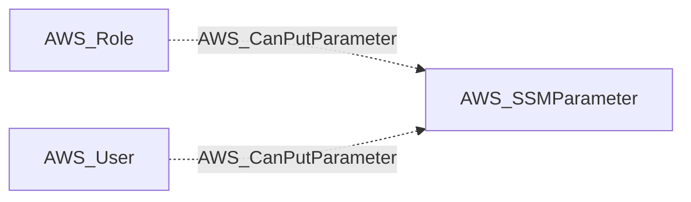

import AwsReferenceBetaNote from '/snippets/opengraph/extensions/aws-reference-beta-note.mdx';

<AwsReferenceBetaNote />

Principal can call ssm:PutParameter to create or update an SSM Parameter Store value.

## Edge Schema

- Source: [AWS_Role](/opengraph/extensions/aws/nodes/aws_role), [AWS_User](/opengraph/extensions/aws/nodes/aws_user)
- Destination: [AWS_SSMParameter](/opengraph/extensions/aws/nodes/aws_ssmparameter)
- Traversable: ❌

This relationship supplies structural or permission evidence and does not independently form an Attack Path step.

### Endpoint pairs

| Source Node Types | Destination Node Types |
| --- | --- |
| [AWS_Role](/opengraph/extensions/aws/nodes/aws_role) | [AWS_SSMParameter](/opengraph/extensions/aws/nodes/aws_ssmparameter) |
| [AWS_User](/opengraph/extensions/aws/nodes/aws_user) | [AWS_SSMParameter](/opengraph/extensions/aws/nodes/aws_ssmparameter) |

## Diagram

## Interpretation

For a customer-key-encrypted SecureString parameter, the collector also requires effective `kms:Encrypt` on the key in the SSM service context. It combines the condition evidence. This data-access projection is limited to the same account.

## Authorization evidence

Associated API action: `ssm:PutParameter`.

## Evaluation limits

This edge represents the collector's model of collected authorization and resource state. It does not prove that every runtime request succeeds. Inspect unresolved `conditions` and `trust_policy_conditions` when present; `has_conditions` and `has_trust_policy_conditions` indicate retained evidence. Composite edges can include `methods` or `composite_components` describing their derivation.

[AWS schema](/opengraph/extensions/aws/schema)
