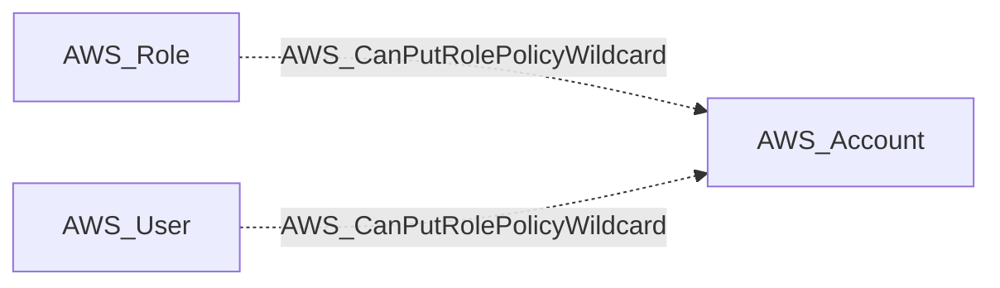

import AwsReferenceBetaNote from '/snippets/opengraph/extensions/aws-reference-beta-note.mdx';

<AwsReferenceBetaNote />

Principal can call iam:PutRolePolicy against the wildcard resource arn:aws:iam::&#123;account&#125;:role/* — authority to write an inline policy onto any role, including yet-to-be-created ones. Wave-0 primitive feeding the CreateAndPassAdminRole composite.

## Edge Schema

- Source: [AWS_Role](/opengraph/extensions/aws/nodes/aws_role), [AWS_User](/opengraph/extensions/aws/nodes/aws_user)
- Destination: [AWS_Account](/opengraph/extensions/aws/nodes/aws_account)
- Traversable: ❌

This relationship supplies structural or permission evidence and does not independently form an Attack Path step.

### Endpoint pairs

| Source Node Types | Destination Node Types |
| --- | --- |
| [AWS_Role](/opengraph/extensions/aws/nodes/aws_role) | [AWS_Account](/opengraph/extensions/aws/nodes/aws_account) |
| [AWS_User](/opengraph/extensions/aws/nodes/aws_user) | [AWS_Account](/opengraph/extensions/aws/nodes/aws_account) |

## Diagram

## Interpretation

The destination is the account in which the capability is modeled, rather than a newly created principal or an existing policy object. The collector combines the relevant policy and principal-control evidence; the schema description above identifies the technique. Review `methods` and `composite_components` when present for the selected evidence and conditions.

## Evaluation limits

This edge represents the collector's model of collected authorization and resource state. It does not prove that every runtime request succeeds. Inspect unresolved `conditions` and `trust_policy_conditions` when present; `has_conditions` and `has_trust_policy_conditions` indicate retained evidence. Composite edges can include `methods` or `composite_components` describing their derivation.

[AWS schema](/opengraph/extensions/aws/schema)
