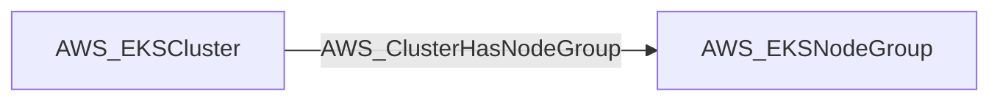

import AwsReferenceBetaNote from '/snippets/opengraph/extensions/aws-reference-beta-note.mdx';

<AwsReferenceBetaNote />

Structural edge from an EKS cluster to one of its managed node groups (derived from the node group's clusterName). Traversable because a Kubernetes admin on the cluster can schedule a pod on the node group via nodeSelector and read the node role's credentials from IMDS.

## Edge Schema

- Source: [AWS_EKSCluster](/opengraph/extensions/aws/nodes/aws_ekscluster)
- Destination: [AWS_EKSNodeGroup](/opengraph/extensions/aws/nodes/aws_eksnodegroup)
- Traversable: ✅

BloodHound can include this relationship in an Attack Path.

### Endpoint pairs

| Source Node Types | Destination Node Types |
| --- | --- |
| [AWS_EKSCluster](/opengraph/extensions/aws/nodes/aws_ekscluster) | [AWS_EKSNodeGroup](/opengraph/extensions/aws/nodes/aws_eksnodegroup) |

## Diagram

## Interpretation

The destination is a managed node group belonging to the source cluster. The model treats cluster administration as a path to node-group workloads; runtime scheduling and metadata access restrictions still matter.

[AWS schema](/opengraph/extensions/aws/schema)
