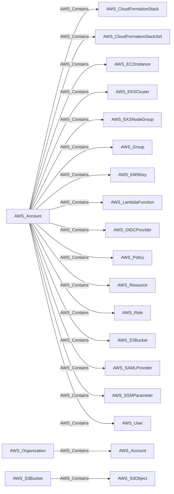

import AwsReferenceBetaNote from '/snippets/opengraph/extensions/aws-reference-beta-note.mdx';

<AwsReferenceBetaNote />

Structural containment (organization contains accounts, account contains principals, buckets, keys, etc.).

## Edge Schema

- Source: [AWS_Account](/opengraph/extensions/aws/nodes/aws_account), [AWS_Organization](/opengraph/extensions/aws/nodes/aws_organization), [AWS_S3Bucket](/opengraph/extensions/aws/nodes/aws_s3bucket)
- Destination: [AWS_CloudFormationStack](/opengraph/extensions/aws/nodes/aws_cloudformationstack), [AWS_CloudFormationStackSet](/opengraph/extensions/aws/nodes/aws_cloudformationstackset), [AWS_EC2Instance](/opengraph/extensions/aws/nodes/aws_ec2instance), [AWS_EKSCluster](/opengraph/extensions/aws/nodes/aws_ekscluster), [AWS_EKSNodeGroup](/opengraph/extensions/aws/nodes/aws_eksnodegroup), [AWS_Group](/opengraph/extensions/aws/nodes/aws_group), [AWS_KMSKey](/opengraph/extensions/aws/nodes/aws_kmskey), [AWS_LambdaFunction](/opengraph/extensions/aws/nodes/aws_lambdafunction), [AWS_OIDCProvider](/opengraph/extensions/aws/nodes/aws_oidcprovider), [AWS_Policy](/opengraph/extensions/aws/nodes/aws_policy), [AWS_Resource](/opengraph/extensions/aws/nodes/aws_resource), [AWS_Role](/opengraph/extensions/aws/nodes/aws_role), [AWS_S3Bucket](/opengraph/extensions/aws/nodes/aws_s3bucket), [AWS_SAMLProvider](/opengraph/extensions/aws/nodes/aws_samlprovider), [AWS_SSMParameter](/opengraph/extensions/aws/nodes/aws_ssmparameter), [AWS_User](/opengraph/extensions/aws/nodes/aws_user), [AWS_Account](/opengraph/extensions/aws/nodes/aws_account), [AWS_S3Object](/opengraph/extensions/aws/nodes/aws_s3object)
- Traversable: ✅

BloodHound can include this relationship in an Attack Path.

### Endpoint pairs

| Source Node Types | Destination Node Types |
| --- | --- |
| [AWS_Account](/opengraph/extensions/aws/nodes/aws_account) | [AWS_CloudFormationStack](/opengraph/extensions/aws/nodes/aws_cloudformationstack) |
| [AWS_Account](/opengraph/extensions/aws/nodes/aws_account) | [AWS_CloudFormationStackSet](/opengraph/extensions/aws/nodes/aws_cloudformationstackset) |
| [AWS_Account](/opengraph/extensions/aws/nodes/aws_account) | [AWS_EC2Instance](/opengraph/extensions/aws/nodes/aws_ec2instance) |
| [AWS_Account](/opengraph/extensions/aws/nodes/aws_account) | [AWS_EKSCluster](/opengraph/extensions/aws/nodes/aws_ekscluster) |
| [AWS_Account](/opengraph/extensions/aws/nodes/aws_account) | [AWS_EKSNodeGroup](/opengraph/extensions/aws/nodes/aws_eksnodegroup) |
| [AWS_Account](/opengraph/extensions/aws/nodes/aws_account) | [AWS_Group](/opengraph/extensions/aws/nodes/aws_group) |
| [AWS_Account](/opengraph/extensions/aws/nodes/aws_account) | [AWS_KMSKey](/opengraph/extensions/aws/nodes/aws_kmskey) |
| [AWS_Account](/opengraph/extensions/aws/nodes/aws_account) | [AWS_LambdaFunction](/opengraph/extensions/aws/nodes/aws_lambdafunction) |
| [AWS_Account](/opengraph/extensions/aws/nodes/aws_account) | [AWS_OIDCProvider](/opengraph/extensions/aws/nodes/aws_oidcprovider) |
| [AWS_Account](/opengraph/extensions/aws/nodes/aws_account) | [AWS_Policy](/opengraph/extensions/aws/nodes/aws_policy) |
| [AWS_Account](/opengraph/extensions/aws/nodes/aws_account) | [AWS_Resource](/opengraph/extensions/aws/nodes/aws_resource) |
| [AWS_Account](/opengraph/extensions/aws/nodes/aws_account) | [AWS_Role](/opengraph/extensions/aws/nodes/aws_role) |
| [AWS_Account](/opengraph/extensions/aws/nodes/aws_account) | [AWS_S3Bucket](/opengraph/extensions/aws/nodes/aws_s3bucket) |
| [AWS_Account](/opengraph/extensions/aws/nodes/aws_account) | [AWS_SAMLProvider](/opengraph/extensions/aws/nodes/aws_samlprovider) |
| [AWS_Account](/opengraph/extensions/aws/nodes/aws_account) | [AWS_SSMParameter](/opengraph/extensions/aws/nodes/aws_ssmparameter) |
| [AWS_Account](/opengraph/extensions/aws/nodes/aws_account) | [AWS_User](/opengraph/extensions/aws/nodes/aws_user) |
| [AWS_Organization](/opengraph/extensions/aws/nodes/aws_organization) | [AWS_Account](/opengraph/extensions/aws/nodes/aws_account) |
| [AWS_S3Bucket](/opengraph/extensions/aws/nodes/aws_s3bucket) | [AWS_S3Object](/opengraph/extensions/aws/nodes/aws_s3object) |

## Diagram

## Interpretation

The source is a containing organization, account, or bucket. The endpoint table lists actual containment pairs rather than allowing every source kind to contain every destination kind.

[AWS schema](/opengraph/extensions/aws/schema)
