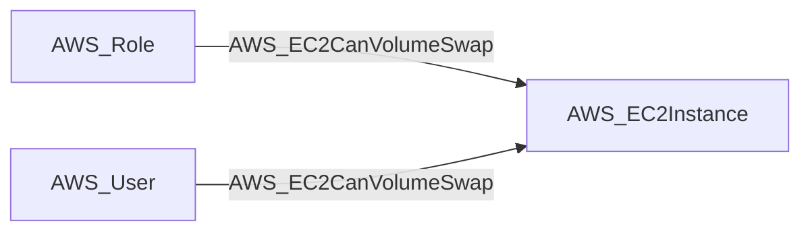

import AwsReferenceBetaNote from '/snippets/opengraph/extensions/aws-reference-beta-note.mdx';

<AwsReferenceBetaNote />

Principal can perform a volume swap attack (StopInstances + DetachVolume + AttachVolume + StartInstances) to gain code execution on an EC2 instance.

## Edge Schema

- Source: [AWS_Role](/opengraph/extensions/aws/nodes/aws_role), [AWS_User](/opengraph/extensions/aws/nodes/aws_user)
- Destination: [AWS_EC2Instance](/opengraph/extensions/aws/nodes/aws_ec2instance)
- Traversable: ✅

BloodHound can include this relationship in an Attack Path.

### Endpoint pairs

| Source Node Types | Destination Node Types |
| --- | --- |
| [AWS_Role](/opengraph/extensions/aws/nodes/aws_role) | [AWS_EC2Instance](/opengraph/extensions/aws/nodes/aws_ec2instance) |
| [AWS_User](/opengraph/extensions/aws/nodes/aws_user) | [AWS_EC2Instance](/opengraph/extensions/aws/nodes/aws_ec2instance) |

## Diagram

## Interpretation

The collector requires all four volume-swap permissions in the same account and a collected instance with an EBS-backed root volume. It suppresses this composite when that resource-state requirement is not met.

## Composite requirements

The collector combines the following permission kinds for the same principal and target. Their presence must satisfy the collector's evaluation and resource-state checks.

- `AWS_CanAttachVolume` (internal permission evidence, not a public schema kind)
- `AWS_CanDetachVolume` (internal permission evidence, not a public schema kind)
- `AWS_CanStartInstance` (internal permission evidence, not a public schema kind)
- `AWS_CanStopInstance` (internal permission evidence, not a public schema kind)

## Evaluation limits

This edge represents the collector's model of collected authorization and resource state. It does not prove that every runtime request succeeds. Inspect unresolved `conditions` and `trust_policy_conditions` when present; `has_conditions` and `has_trust_policy_conditions` indicate retained evidence. Composite edges can include `methods` or `composite_components` describing their derivation.

[AWS schema](/opengraph/extensions/aws/schema)
