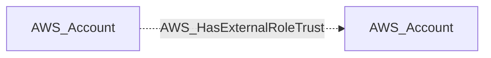

import AwsReferenceBetaNote from '/snippets/opengraph/extensions/aws-reference-beta-note.mdx';

<AwsReferenceBetaNote />

Role has a trust policy entry for a principal in a different AWS account (cross-account trust).

## Edge Schema

- Source: [AWS_Account](/opengraph/extensions/aws/nodes/aws_account)
- Destination: [AWS_Account](/opengraph/extensions/aws/nodes/aws_account)
- Traversable: ❌

This relationship supplies structural or permission evidence and does not independently form an Attack Path step.

### Endpoint pairs

| Source Node Types | Destination Node Types |
| --- | --- |
| [AWS_Account](/opengraph/extensions/aws/nodes/aws_account) | [AWS_Account](/opengraph/extensions/aws/nodes/aws_account) |

## Diagram

## Interpretation

The source is the account containing the trusting role. The destination is the external account trusted by that role. This summarizes cross-account trust; it does not itself establish effective permission to assume the role.

[AWS schema](/opengraph/extensions/aws/schema)
