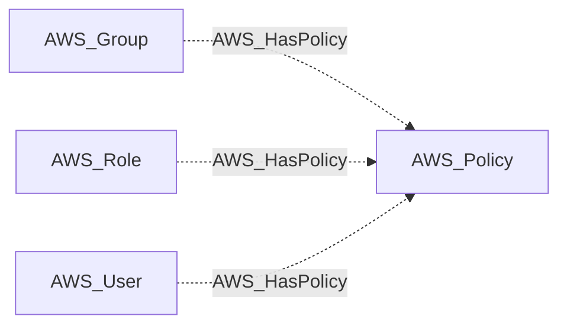

import AwsReferenceBetaNote from '/snippets/opengraph/extensions/aws-reference-beta-note.mdx';

<AwsReferenceBetaNote />

Principal (user, group, or role) has a managed policy attached.

## Edge Schema

- Source: [AWS_Group](/opengraph/extensions/aws/nodes/aws_group), [AWS_Role](/opengraph/extensions/aws/nodes/aws_role), [AWS_User](/opengraph/extensions/aws/nodes/aws_user)
- Destination: [AWS_Policy](/opengraph/extensions/aws/nodes/aws_policy)
- Traversable: ❌

This relationship supplies structural or permission evidence and does not independently form an Attack Path step.

### Endpoint pairs

| Source Node Types | Destination Node Types |
| --- | --- |
| [AWS_Group](/opengraph/extensions/aws/nodes/aws_group) | [AWS_Policy](/opengraph/extensions/aws/nodes/aws_policy) |
| [AWS_Role](/opengraph/extensions/aws/nodes/aws_role) | [AWS_Policy](/opengraph/extensions/aws/nodes/aws_policy) |
| [AWS_User](/opengraph/extensions/aws/nodes/aws_user) | [AWS_Policy](/opengraph/extensions/aws/nodes/aws_policy) |

## Diagram

[AWS schema](/opengraph/extensions/aws/schema)
