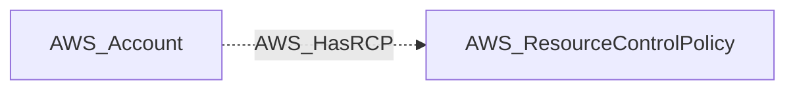

import AwsReferenceBetaNote from '/snippets/opengraph/extensions/aws-reference-beta-note.mdx';

<AwsReferenceBetaNote />

Organization has a resource control policy.

## Edge Schema

- Source: [AWS_Account](/opengraph/extensions/aws/nodes/aws_account)
- Destination: [AWS_ResourceControlPolicy](/opengraph/extensions/aws/nodes/aws_resourcecontrolpolicy)
- Traversable: ❌

This relationship supplies structural or permission evidence and does not independently form an Attack Path step.

### Endpoint pairs

| Source Node Types | Destination Node Types |
| --- | --- |
| [AWS_Account](/opengraph/extensions/aws/nodes/aws_account) | [AWS_ResourceControlPolicy](/opengraph/extensions/aws/nodes/aws_resourcecontrolpolicy) |

## Diagram

## Interpretation

The emitted direction is from an account to a resource control policy that applies directly or through inheritance. The schema description uses “Organization”; the collector projects this relationship onto affected accounts.

[AWS schema](/opengraph/extensions/aws/schema)
