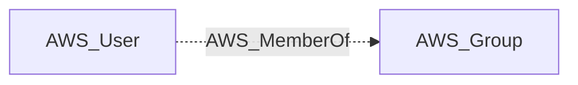

import AwsReferenceBetaNote from '/snippets/opengraph/extensions/aws-reference-beta-note.mdx';

<AwsReferenceBetaNote />

Structural edge: an IAM user is a member of an IAM group (derived from the user's GroupList), inheriting the group's attached and inline policies.

## Edge Schema

- Source: [AWS_User](/opengraph/extensions/aws/nodes/aws_user)
- Destination: [AWS_Group](/opengraph/extensions/aws/nodes/aws_group)
- Traversable: ❌

This relationship supplies structural or permission evidence and does not independently form an Attack Path step.

### Endpoint pairs

| Source Node Types | Destination Node Types |
| --- | --- |
| [AWS_User](/opengraph/extensions/aws/nodes/aws_user) | [AWS_Group](/opengraph/extensions/aws/nodes/aws_group) |

## Diagram

[AWS schema](/opengraph/extensions/aws/schema)
