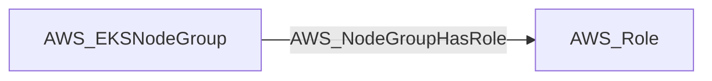

import AwsReferenceBetaNote from '/snippets/opengraph/extensions/aws-reference-beta-note.mdx';

<AwsReferenceBetaNote />

Structural edge from an EKS node group to its node IAM role (from the node group's nodeRole). Traversable because scheduling a pod on the node group exposes that role's credentials via the EC2 Instance Metadata Service at 169.254.169.254.

## Edge Schema

- Source: [AWS_EKSNodeGroup](/opengraph/extensions/aws/nodes/aws_eksnodegroup)
- Destination: [AWS_Role](/opengraph/extensions/aws/nodes/aws_role)
- Traversable: ✅

BloodHound can include this relationship in an Attack Path.

### Endpoint pairs

| Source Node Types | Destination Node Types |
| --- | --- |
| [AWS_EKSNodeGroup](/opengraph/extensions/aws/nodes/aws_eksnodegroup) | [AWS_Role](/opengraph/extensions/aws/nodes/aws_role) |

## Diagram

## Interpretation

The destination is the node IAM role recorded on the managed node group. Traversability models access to that role through workloads on the node group; runtime metadata access restrictions still matter.

[AWS schema](/opengraph/extensions/aws/schema)
