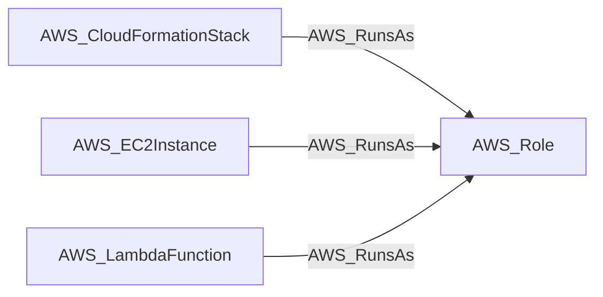

import AwsReferenceBetaNote from '/snippets/opengraph/extensions/aws-reference-beta-note.mdx';

<AwsReferenceBetaNote />

Compute resource (EC2 instance, Lambda function, CloudFormation stack) executes as an IAM role.

## Edge Schema

- Source: [AWS_CloudFormationStack](/opengraph/extensions/aws/nodes/aws_cloudformationstack), [AWS_EC2Instance](/opengraph/extensions/aws/nodes/aws_ec2instance), [AWS_LambdaFunction](/opengraph/extensions/aws/nodes/aws_lambdafunction)
- Destination: [AWS_Role](/opengraph/extensions/aws/nodes/aws_role)
- Traversable: ✅

BloodHound can include this relationship in an Attack Path.

### Endpoint pairs

| Source Node Types | Destination Node Types |
| --- | --- |
| [AWS_CloudFormationStack](/opengraph/extensions/aws/nodes/aws_cloudformationstack) | [AWS_Role](/opengraph/extensions/aws/nodes/aws_role) |
| [AWS_EC2Instance](/opengraph/extensions/aws/nodes/aws_ec2instance) | [AWS_Role](/opengraph/extensions/aws/nodes/aws_role) |
| [AWS_LambdaFunction](/opengraph/extensions/aws/nodes/aws_lambdafunction) | [AWS_Role](/opengraph/extensions/aws/nodes/aws_role) |

## Diagram

[AWS schema](/opengraph/extensions/aws/schema)
