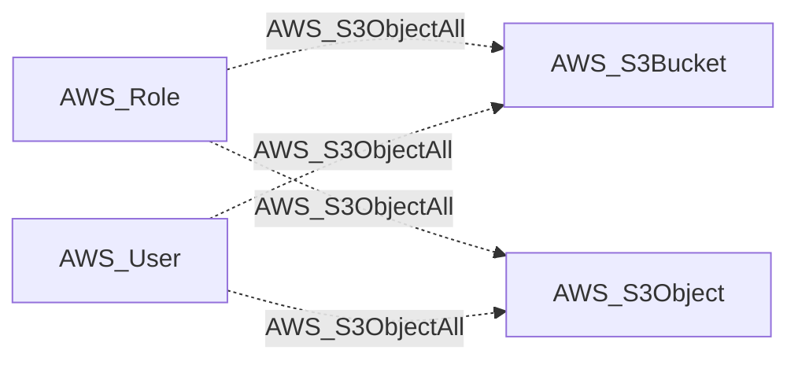

import AwsReferenceBetaNote from '/snippets/opengraph/extensions/aws-reference-beta-note.mdx';

<AwsReferenceBetaNote />

Principal has all S3 object permissions (Write + DeleteObject + PutObjectAcl).

## Edge Schema

- Source: [AWS_Role](/opengraph/extensions/aws/nodes/aws_role), [AWS_User](/opengraph/extensions/aws/nodes/aws_user)
- Destination: [AWS_S3Bucket](/opengraph/extensions/aws/nodes/aws_s3bucket), [AWS_S3Object](/opengraph/extensions/aws/nodes/aws_s3object)
- Traversable: ❌

This relationship supplies structural or permission evidence and does not independently form an Attack Path step.

### Endpoint pairs

| Source Node Types | Destination Node Types |
| --- | --- |
| [AWS_Role](/opengraph/extensions/aws/nodes/aws_role) | [AWS_S3Bucket](/opengraph/extensions/aws/nodes/aws_s3bucket) |
| [AWS_Role](/opengraph/extensions/aws/nodes/aws_role) | [AWS_S3Object](/opengraph/extensions/aws/nodes/aws_s3object) |
| [AWS_User](/opengraph/extensions/aws/nodes/aws_user) | [AWS_S3Bucket](/opengraph/extensions/aws/nodes/aws_s3bucket) |
| [AWS_User](/opengraph/extensions/aws/nodes/aws_user) | [AWS_S3Object](/opengraph/extensions/aws/nodes/aws_s3object) |

## Diagram

## Interpretation

A bucket destination represents authorization against the modeled object namespace, not every concrete object key. The collector can also emit this capability on a concrete collected object; namespace coverage can suppress redundant object edges.

## Composite requirements

The collector combines the following permission kinds for the same principal and target. Their presence must satisfy the collector's evaluation and resource-state checks.

- [AWS_CanDeleteObject](/opengraph/extensions/aws/edges/aws_candeleteobject)
- [AWS_CanGetObject](/opengraph/extensions/aws/edges/aws_cangetobject)
- [AWS_CanGetObjectACL](/opengraph/extensions/aws/edges/aws_cangetobjectacl)
- [AWS_CanPutObject](/opengraph/extensions/aws/edges/aws_canputobject)
- [AWS_CanPutObjectACL](/opengraph/extensions/aws/edges/aws_canputobjectacl)

## Evaluation limits

This edge represents the collector's model of collected authorization and resource state. It does not prove that every runtime request succeeds. Inspect unresolved `conditions` and `trust_policy_conditions` when present; `has_conditions` and `has_trust_policy_conditions` indicate retained evidence. Composite edges can include `methods` or `composite_components` describing their derivation.

[AWS schema](/opengraph/extensions/aws/schema)
