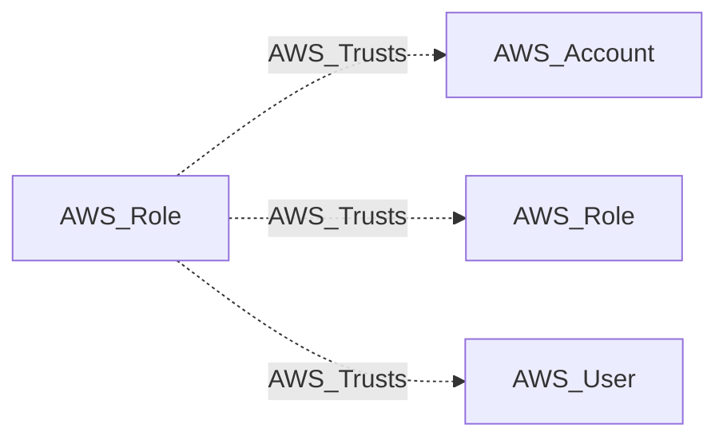

import AwsReferenceBetaNote from '/snippets/opengraph/extensions/aws-reference-beta-note.mdx';

<AwsReferenceBetaNote />

Role trusts a principal via its trust policy (role -&gt; trusted entity).

## Edge Schema

- Source: [AWS_Role](/opengraph/extensions/aws/nodes/aws_role)
- Destination: [AWS_Account](/opengraph/extensions/aws/nodes/aws_account), [AWS_Role](/opengraph/extensions/aws/nodes/aws_role), [AWS_User](/opengraph/extensions/aws/nodes/aws_user)
- Traversable: ❌

This relationship supplies structural or permission evidence and does not independently form an Attack Path step.

### Endpoint pairs

| Source Node Types | Destination Node Types |
| --- | --- |
| [AWS_Role](/opengraph/extensions/aws/nodes/aws_role) | [AWS_Account](/opengraph/extensions/aws/nodes/aws_account) |
| [AWS_Role](/opengraph/extensions/aws/nodes/aws_role) | [AWS_Role](/opengraph/extensions/aws/nodes/aws_role) |
| [AWS_Role](/opengraph/extensions/aws/nodes/aws_role) | [AWS_User](/opengraph/extensions/aws/nodes/aws_user) |

## Diagram

[AWS schema](/opengraph/extensions/aws/schema)
