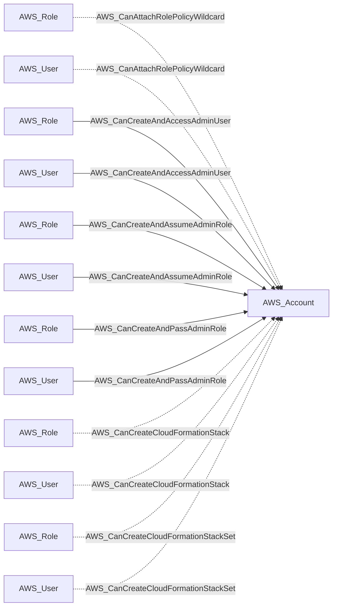
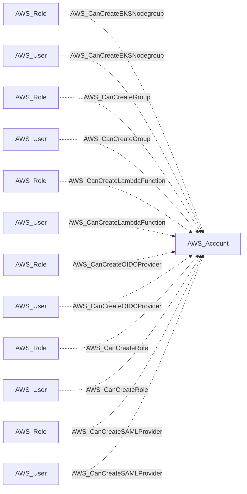
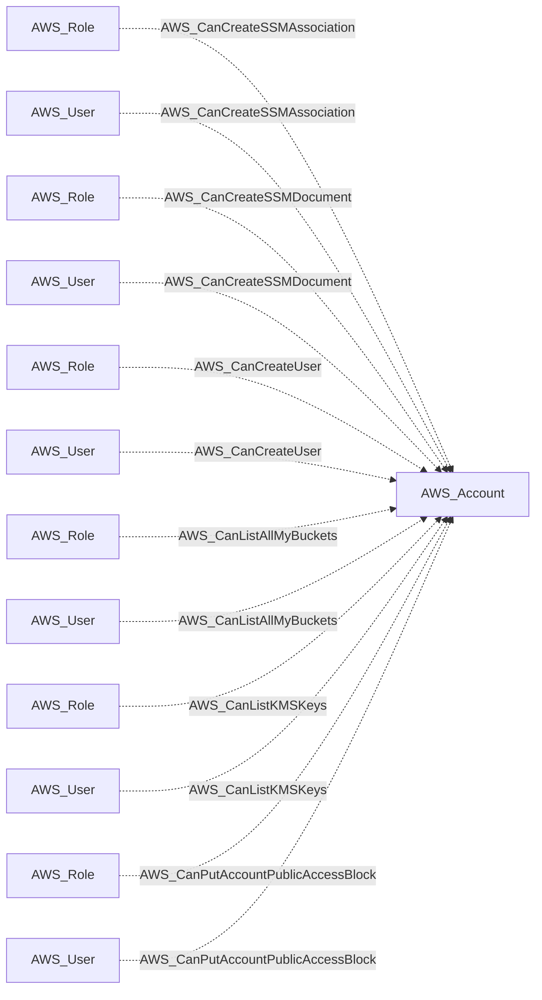
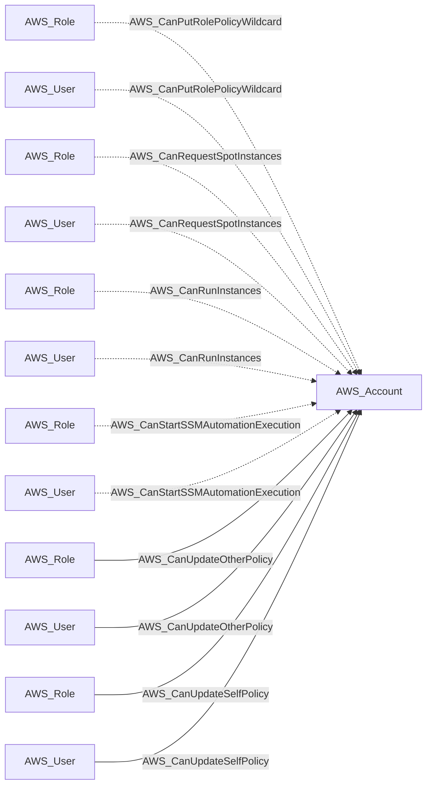
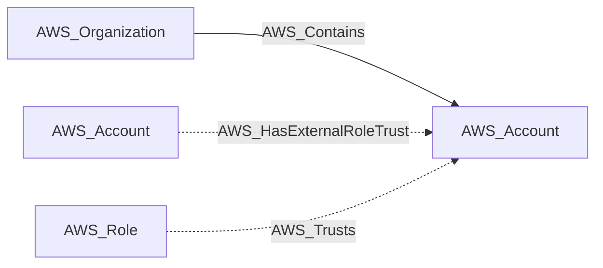
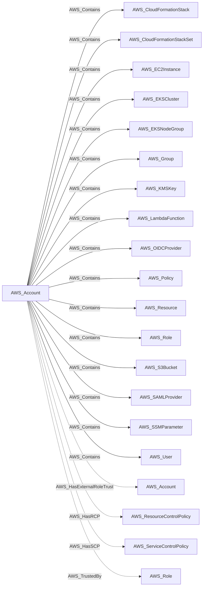

import AwsReferenceBetaNote from '/snippets/opengraph/extensions/aws-reference-beta-note.mdx';

<AwsReferenceBetaNote />

An AWS account within an organization or standalone.

## Identifier

The node identifier is the account root ARN: `arn:aws:iam::<account-id>:root`. This ARN also identifies the account environment.

## Properties

Types below describe collected values. `null` means the value can be unavailable; it does not make the AWS resource optional. Collection scope and API responses determine which metadata is available.

| Property | Type | Description |
| --- | --- | --- |
| `name` | `str` | Collector-generated name used to identify the resource in context. |
| `displayname` | `str` | Resource label shown in the graph. |
| `arn` | `str or null` | AWS Resource Name used as the node identifier. |
| `account_id` | `str or null` | AWS account associated with the resource; nullable in the shared model. |
| `region` | `str or null` | AWS region, or `global` for resources without a regional scope. |
| `environmentid` | `str` | Account root ARN identifying the OpenGraph environment. |
| `org_id` | `str or null` | AWS Organizations organization ID containing the account. |
| `org_path` | `str or null` | PrincipalOrgPaths-style hierarchy for the account. |
| `management_account_id` | `str or null` | Management account ID for the organization. |
| `collected` | `bool` | True for an account targeted by collection. |

## Diagram

Solid arrows show traversable edges; dotted arrows show non-traversable edges. Each view shows the node in relation to the listed endpoint types.

### Inbound edges (1)

### Inbound edges (2)

### Inbound edges (3)

### Inbound edges (4)

### Inbound edges (5)

### Outbound edges

## Edges

These tables cover relationships emitted for this kind by the AWS collector. Other extensions can define additional relationships.

### Inbound Edges

| Edge Type | Source Node Types | Traversable |
| --- | --- | --- |
| [AWS_CanAttachRolePolicyWildcard](/opengraph/extensions/aws/edges/aws_canattachrolepolicywildcard) | [AWS_Role](/opengraph/extensions/aws/nodes/aws_role), [AWS_User](/opengraph/extensions/aws/nodes/aws_user) | ❌ |
| [AWS_CanCreateAndAccessAdminUser](/opengraph/extensions/aws/edges/aws_cancreateandaccessadminuser) | [AWS_Role](/opengraph/extensions/aws/nodes/aws_role), [AWS_User](/opengraph/extensions/aws/nodes/aws_user) | ✅ |
| [AWS_CanCreateAndAssumeAdminRole](/opengraph/extensions/aws/edges/aws_cancreateandassumeadminrole) | [AWS_Role](/opengraph/extensions/aws/nodes/aws_role), [AWS_User](/opengraph/extensions/aws/nodes/aws_user) | ✅ |
| [AWS_CanCreateAndPassAdminRole](/opengraph/extensions/aws/edges/aws_cancreateandpassadminrole) | [AWS_Role](/opengraph/extensions/aws/nodes/aws_role), [AWS_User](/opengraph/extensions/aws/nodes/aws_user) | ✅ |
| [AWS_CanCreateCloudFormationStack](/opengraph/extensions/aws/edges/aws_cancreatecloudformationstack) | [AWS_Role](/opengraph/extensions/aws/nodes/aws_role), [AWS_User](/opengraph/extensions/aws/nodes/aws_user) | ❌ |
| [AWS_CanCreateCloudFormationStackSet](/opengraph/extensions/aws/edges/aws_cancreatecloudformationstackset) | [AWS_Role](/opengraph/extensions/aws/nodes/aws_role), [AWS_User](/opengraph/extensions/aws/nodes/aws_user) | ❌ |
| [AWS_CanCreateEKSNodegroup](/opengraph/extensions/aws/edges/aws_cancreateeksnodegroup) | [AWS_Role](/opengraph/extensions/aws/nodes/aws_role), [AWS_User](/opengraph/extensions/aws/nodes/aws_user) | ❌ |
| [AWS_CanCreateGroup](/opengraph/extensions/aws/edges/aws_cancreategroup) | [AWS_Role](/opengraph/extensions/aws/nodes/aws_role), [AWS_User](/opengraph/extensions/aws/nodes/aws_user) | ❌ |
| [AWS_CanCreateLambdaFunction](/opengraph/extensions/aws/edges/aws_cancreatelambdafunction) | [AWS_Role](/opengraph/extensions/aws/nodes/aws_role), [AWS_User](/opengraph/extensions/aws/nodes/aws_user) | ❌ |
| [AWS_CanCreateOIDCProvider](/opengraph/extensions/aws/edges/aws_cancreateoidcprovider) | [AWS_Role](/opengraph/extensions/aws/nodes/aws_role), [AWS_User](/opengraph/extensions/aws/nodes/aws_user) | ❌ |
| [AWS_CanCreateRole](/opengraph/extensions/aws/edges/aws_cancreaterole) | [AWS_Role](/opengraph/extensions/aws/nodes/aws_role), [AWS_User](/opengraph/extensions/aws/nodes/aws_user) | ❌ |
| [AWS_CanCreateSAMLProvider](/opengraph/extensions/aws/edges/aws_cancreatesamlprovider) | [AWS_Role](/opengraph/extensions/aws/nodes/aws_role), [AWS_User](/opengraph/extensions/aws/nodes/aws_user) | ❌ |
| [AWS_CanCreateSSMAssociation](/opengraph/extensions/aws/edges/aws_cancreatessmassociation) | [AWS_Role](/opengraph/extensions/aws/nodes/aws_role), [AWS_User](/opengraph/extensions/aws/nodes/aws_user) | ❌ |
| [AWS_CanCreateSSMDocument](/opengraph/extensions/aws/edges/aws_cancreatessmdocument) | [AWS_Role](/opengraph/extensions/aws/nodes/aws_role), [AWS_User](/opengraph/extensions/aws/nodes/aws_user) | ❌ |
| [AWS_CanCreateUser](/opengraph/extensions/aws/edges/aws_cancreateuser) | [AWS_Role](/opengraph/extensions/aws/nodes/aws_role), [AWS_User](/opengraph/extensions/aws/nodes/aws_user) | ❌ |
| [AWS_CanListAllMyBuckets](/opengraph/extensions/aws/edges/aws_canlistallmybuckets) | [AWS_Role](/opengraph/extensions/aws/nodes/aws_role), [AWS_User](/opengraph/extensions/aws/nodes/aws_user) | ❌ |
| [AWS_CanListKMSKeys](/opengraph/extensions/aws/edges/aws_canlistkmskeys) | [AWS_Role](/opengraph/extensions/aws/nodes/aws_role), [AWS_User](/opengraph/extensions/aws/nodes/aws_user) | ❌ |
| [AWS_CanPutAccountPublicAccessBlock](/opengraph/extensions/aws/edges/aws_canputaccountpublicaccessblock) | [AWS_Role](/opengraph/extensions/aws/nodes/aws_role), [AWS_User](/opengraph/extensions/aws/nodes/aws_user) | ❌ |
| [AWS_CanPutRolePolicyWildcard](/opengraph/extensions/aws/edges/aws_canputrolepolicywildcard) | [AWS_Role](/opengraph/extensions/aws/nodes/aws_role), [AWS_User](/opengraph/extensions/aws/nodes/aws_user) | ❌ |
| [AWS_CanRequestSpotInstances](/opengraph/extensions/aws/edges/aws_canrequestspotinstances) | [AWS_Role](/opengraph/extensions/aws/nodes/aws_role), [AWS_User](/opengraph/extensions/aws/nodes/aws_user) | ❌ |
| [AWS_CanRunInstances](/opengraph/extensions/aws/edges/aws_canruninstances) | [AWS_Role](/opengraph/extensions/aws/nodes/aws_role), [AWS_User](/opengraph/extensions/aws/nodes/aws_user) | ❌ |
| [AWS_CanStartSSMAutomationExecution](/opengraph/extensions/aws/edges/aws_canstartssmautomationexecution) | [AWS_Role](/opengraph/extensions/aws/nodes/aws_role), [AWS_User](/opengraph/extensions/aws/nodes/aws_user) | ❌ |
| [AWS_CanUpdateOtherPolicy](/opengraph/extensions/aws/edges/aws_canupdateotherpolicy) | [AWS_Role](/opengraph/extensions/aws/nodes/aws_role), [AWS_User](/opengraph/extensions/aws/nodes/aws_user) | ✅ |
| [AWS_CanUpdateSelfPolicy](/opengraph/extensions/aws/edges/aws_canupdateselfpolicy) | [AWS_Role](/opengraph/extensions/aws/nodes/aws_role), [AWS_User](/opengraph/extensions/aws/nodes/aws_user) | ✅ |
| [AWS_Contains](/opengraph/extensions/aws/edges/aws_contains) | [AWS_Organization](/opengraph/extensions/aws/nodes/aws_organization) | ✅ |
| [AWS_HasExternalRoleTrust](/opengraph/extensions/aws/edges/aws_hasexternalroletrust) | [AWS_Account](/opengraph/extensions/aws/nodes/aws_account) | ❌ |
| [AWS_Trusts](/opengraph/extensions/aws/edges/aws_trusts) | [AWS_Role](/opengraph/extensions/aws/nodes/aws_role) | ❌ |

### Outbound Edges

| Edge Type | Destination Node Types | Traversable |
| --- | --- | --- |
| [AWS_Contains](/opengraph/extensions/aws/edges/aws_contains) | [AWS_CloudFormationStack](/opengraph/extensions/aws/nodes/aws_cloudformationstack), [AWS_CloudFormationStackSet](/opengraph/extensions/aws/nodes/aws_cloudformationstackset), [AWS_EC2Instance](/opengraph/extensions/aws/nodes/aws_ec2instance), [AWS_EKSCluster](/opengraph/extensions/aws/nodes/aws_ekscluster), [AWS_EKSNodeGroup](/opengraph/extensions/aws/nodes/aws_eksnodegroup), [AWS_Group](/opengraph/extensions/aws/nodes/aws_group), [AWS_KMSKey](/opengraph/extensions/aws/nodes/aws_kmskey), [AWS_LambdaFunction](/opengraph/extensions/aws/nodes/aws_lambdafunction), [AWS_OIDCProvider](/opengraph/extensions/aws/nodes/aws_oidcprovider), [AWS_Policy](/opengraph/extensions/aws/nodes/aws_policy), [AWS_Resource](/opengraph/extensions/aws/nodes/aws_resource), [AWS_Role](/opengraph/extensions/aws/nodes/aws_role), [AWS_S3Bucket](/opengraph/extensions/aws/nodes/aws_s3bucket), [AWS_SAMLProvider](/opengraph/extensions/aws/nodes/aws_samlprovider), [AWS_SSMParameter](/opengraph/extensions/aws/nodes/aws_ssmparameter), [AWS_User](/opengraph/extensions/aws/nodes/aws_user) | ✅ |
| [AWS_HasExternalRoleTrust](/opengraph/extensions/aws/edges/aws_hasexternalroletrust) | [AWS_Account](/opengraph/extensions/aws/nodes/aws_account) | ❌ |
| [AWS_HasRCP](/opengraph/extensions/aws/edges/aws_hasrcp) | [AWS_ResourceControlPolicy](/opengraph/extensions/aws/nodes/aws_resourcecontrolpolicy) | ❌ |
| [AWS_HasSCP](/opengraph/extensions/aws/edges/aws_hasscp) | [AWS_ServiceControlPolicy](/opengraph/extensions/aws/nodes/aws_servicecontrolpolicy) | ❌ |
| [AWS_TrustedBy](/opengraph/extensions/aws/edges/aws_trustedby) | [AWS_Role](/opengraph/extensions/aws/nodes/aws_role) | ❌ |

[AWS schema](/opengraph/extensions/aws/schema)
