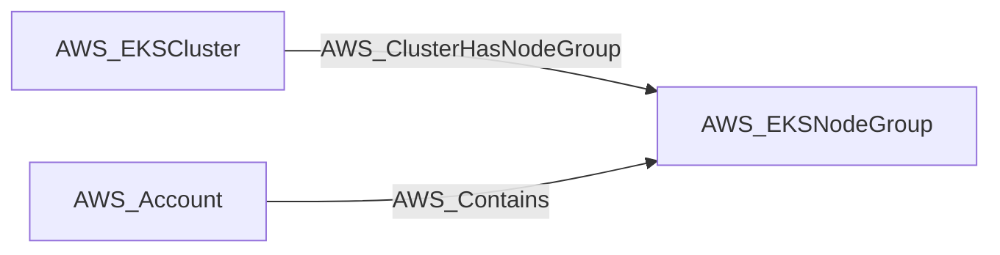
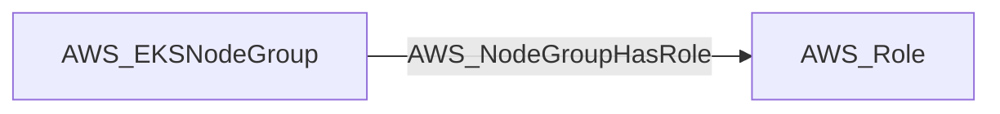

import AwsReferenceBetaNote from '/snippets/opengraph/extensions/aws-reference-beta-note.mdx';

<AwsReferenceBetaNote />

An EKS managed node group — a pool of EC2 worker instances backing a cluster, sharing a node IAM role, AMI type, capacity type, and scaling configuration.

## Identifier

The node identifier is the resource ARN in `arn`.

## Properties

Types below describe collected values. `null` means the value can be unavailable; it does not make the AWS resource optional. Collection scope and API responses determine which metadata is available.

| Property | Type | Description |
| --- | --- | --- |
| `name` | `str` | Collector-generated name used to identify the resource in context. |
| `displayname` | `str` | Resource label shown in the graph. |
| `arn` | `str or null` | AWS Resource Name used as the node identifier. |
| `account_id` | `str or null` | AWS account associated with the resource; nullable in the shared model. |
| `region` | `str or null` | AWS region, or `global` for resources without a regional scope. |
| `environmentid` | `str` | Account root ARN identifying the OpenGraph environment. |
| `cluster_name` | `str or null` | Name of the EKS cluster that owns the node group. |
| `cluster_arn` | `str or null` | ARN of the EKS cluster that owns the node group. |
| `node_role` | `str or null` | IAM role ARN used by nodes in the node group. |
| `status` | `str or null` | Current EKS node group status. |
| `ami_type` | `str or null` | AMI type used by the node group. |
| `capacity_type` | `str or null` | Node group capacity type. |
| `instance_types` | `list[str] or null` | EC2 instance types used by the node group. |
| `min_size` | `int or null` | Minimum configured node count. |
| `max_size` | `int or null` | Maximum configured node count. |
| `desired_size` | `int or null` | Desired configured node count. |
| `tags` | `list[str] or null` | AWS tags attached to the node group. |

## Diagram

Solid arrows show traversable edges; dotted arrows show non-traversable edges. Each view shows the node in relation to the listed endpoint types.

### Inbound edges

### Outbound edges

## Edges

These tables cover relationships emitted for this kind by the AWS collector. Other extensions can define additional relationships.

### Inbound Edges

| Edge Type | Source Node Types | Traversable |
| --- | --- | --- |
| [AWS_ClusterHasNodeGroup](/opengraph/extensions/aws/edges/aws_clusterhasnodegroup) | [AWS_EKSCluster](/opengraph/extensions/aws/nodes/aws_ekscluster) | ✅ |
| [AWS_Contains](/opengraph/extensions/aws/edges/aws_contains) | [AWS_Account](/opengraph/extensions/aws/nodes/aws_account) | ✅ |

### Outbound Edges

| Edge Type | Destination Node Types | Traversable |
| --- | --- | --- |
| [AWS_NodeGroupHasRole](/opengraph/extensions/aws/edges/aws_nodegrouphasrole) | [AWS_Role](/opengraph/extensions/aws/nodes/aws_role) | ✅ |

[AWS schema](/opengraph/extensions/aws/schema)
