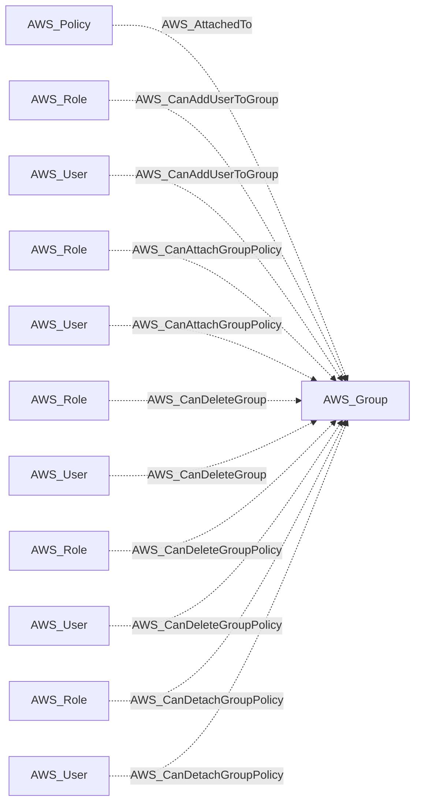
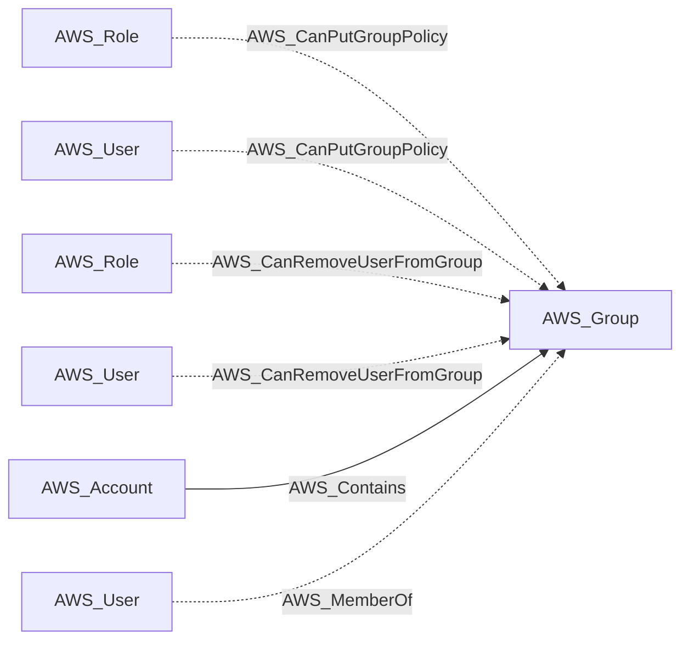
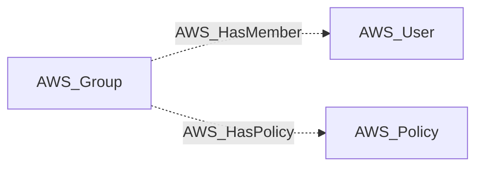

import AwsReferenceBetaNote from '/snippets/opengraph/extensions/aws-reference-beta-note.mdx';

<AwsReferenceBetaNote />

An IAM group that aggregates users for shared policy attachment.

## Identifier

The node identifier is the resource ARN in `arn`.

## Properties

Types below describe collected values. `null` means the value can be unavailable; it does not make the AWS resource optional. Collection scope and API responses determine which metadata is available.

| Property | Type | Description |
| --- | --- | --- |
| `name` | `str` | Collector-generated name used to identify the resource in context. |
| `displayname` | `str` | Resource label shown in the graph. |
| `arn` | `str or null` | AWS Resource Name used as the node identifier. |
| `account_id` | `str or null` | AWS account associated with the resource; nullable in the shared model. |
| `region` | `str or null` | AWS region, or `global` for resources without a regional scope. |
| `environmentid` | `str` | Account root ARN identifying the OpenGraph environment. |
| `group_name` | `str` | Native IAM group name. |
| `create_date` | `str` | Timestamp when the group was created. |
| `group_id` | `str` | Native IAM group identifier. |
| `path` | `str` | IAM path assigned to the group. |
| `inline_policies` | `list[str] or null` | Inline policy documents encoded as JSON strings on the principal. |

## Interpretation

IAM groups supply policies to their members. Effective permission edges are projected from IAM users and roles, rather than treating the group as an authenticating identity.

## Diagram

Solid arrows show traversable edges; dotted arrows show non-traversable edges. Each view shows the node in relation to the listed endpoint types.

### Inbound edges (1)

### Inbound edges (2)

### Outbound edges

## Edges

These tables cover relationships emitted for this kind by the AWS collector. Other extensions can define additional relationships.

### Inbound Edges

| Edge Type | Source Node Types | Traversable |
| --- | --- | --- |
| [AWS_AttachedTo](/opengraph/extensions/aws/edges/aws_attachedto) | [AWS_Policy](/opengraph/extensions/aws/nodes/aws_policy) | ❌ |
| [AWS_CanAddUserToGroup](/opengraph/extensions/aws/edges/aws_canaddusertogroup) | [AWS_Role](/opengraph/extensions/aws/nodes/aws_role), [AWS_User](/opengraph/extensions/aws/nodes/aws_user) | ❌ |
| [AWS_CanAttachGroupPolicy](/opengraph/extensions/aws/edges/aws_canattachgrouppolicy) | [AWS_Role](/opengraph/extensions/aws/nodes/aws_role), [AWS_User](/opengraph/extensions/aws/nodes/aws_user) | ❌ |
| [AWS_CanDeleteGroup](/opengraph/extensions/aws/edges/aws_candeletegroup) | [AWS_Role](/opengraph/extensions/aws/nodes/aws_role), [AWS_User](/opengraph/extensions/aws/nodes/aws_user) | ❌ |
| [AWS_CanDeleteGroupPolicy](/opengraph/extensions/aws/edges/aws_candeletegrouppolicy) | [AWS_Role](/opengraph/extensions/aws/nodes/aws_role), [AWS_User](/opengraph/extensions/aws/nodes/aws_user) | ❌ |
| [AWS_CanDetachGroupPolicy](/opengraph/extensions/aws/edges/aws_candetachgrouppolicy) | [AWS_Role](/opengraph/extensions/aws/nodes/aws_role), [AWS_User](/opengraph/extensions/aws/nodes/aws_user) | ❌ |
| [AWS_CanPutGroupPolicy](/opengraph/extensions/aws/edges/aws_canputgrouppolicy) | [AWS_Role](/opengraph/extensions/aws/nodes/aws_role), [AWS_User](/opengraph/extensions/aws/nodes/aws_user) | ❌ |
| [AWS_CanRemoveUserFromGroup](/opengraph/extensions/aws/edges/aws_canremoveuserfromgroup) | [AWS_Role](/opengraph/extensions/aws/nodes/aws_role), [AWS_User](/opengraph/extensions/aws/nodes/aws_user) | ❌ |
| [AWS_Contains](/opengraph/extensions/aws/edges/aws_contains) | [AWS_Account](/opengraph/extensions/aws/nodes/aws_account) | ✅ |
| [AWS_MemberOf](/opengraph/extensions/aws/edges/aws_memberof) | [AWS_User](/opengraph/extensions/aws/nodes/aws_user) | ❌ |

### Outbound Edges

| Edge Type | Destination Node Types | Traversable |
| --- | --- | --- |
| [AWS_HasMember](/opengraph/extensions/aws/edges/aws_hasmember) | [AWS_User](/opengraph/extensions/aws/nodes/aws_user) | ❌ |
| [AWS_HasPolicy](/opengraph/extensions/aws/edges/aws_haspolicy) | [AWS_Policy](/opengraph/extensions/aws/nodes/aws_policy) | ❌ |

[AWS schema](/opengraph/extensions/aws/schema)
