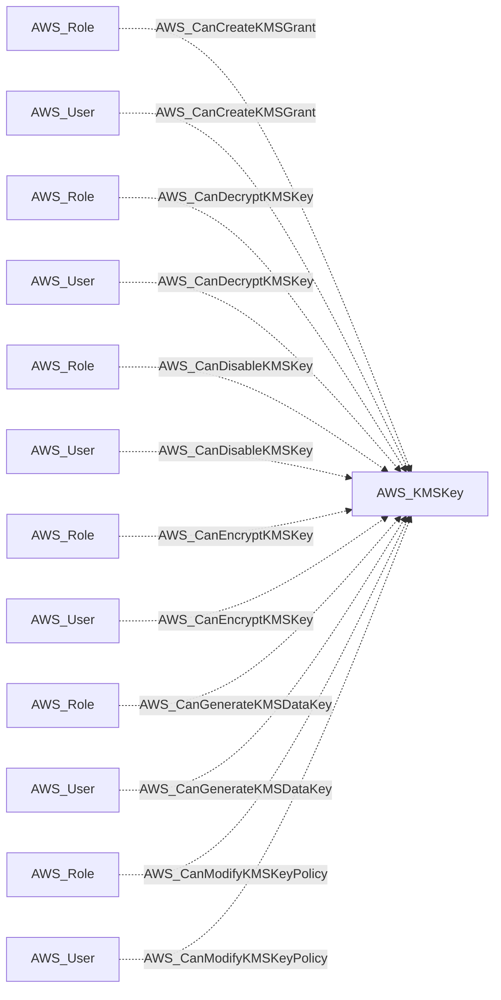
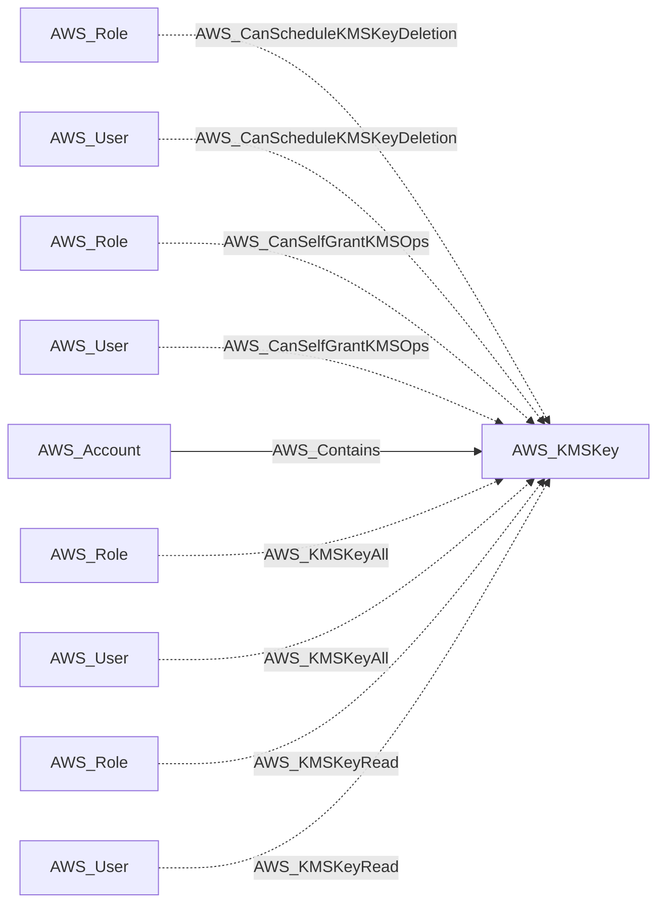

import AwsReferenceBetaNote from '/snippets/opengraph/extensions/aws-reference-beta-note.mdx';

<AwsReferenceBetaNote />

An AWS KMS customer master key used for encryption, decryption, and key management.

## Identifier

The node identifier is the resource ARN in `arn`.

## Properties

Types below describe collected values. `null` means the value can be unavailable; it does not make the AWS resource optional. Collection scope and API responses determine which metadata is available.

| Property | Type | Description |
| --- | --- | --- |
| `name` | `str` | Collector-generated name used to identify the resource in context. |
| `displayname` | `str` | Resource label shown in the graph. |
| `arn` | `str or null` | AWS Resource Name used as the node identifier. |
| `account_id` | `str or null` | AWS account associated with the resource; nullable in the shared model. |
| `region` | `str or null` | AWS region, or `global` for resources without a regional scope. |
| `environmentid` | `str` | Account root ARN identifying the OpenGraph environment. |
| `key_id` | `str` | Native KMS key identifier. |
| `creation_date` | `str or null` | Timestamp when the key was created. |
| `key_state` | `str or null` | Current KMS key state. |
| `key_manager` | `str or null` | KMS key manager, such as CUSTOMER or AWS. |
| `key_spec` | `str or null` | KMS key spec. |
| `key_usage` | `str or null` | KMS key usage. |
| `origin` | `str or null` | Origin of key material. |
| `description` | `str or null` | KMS key description. |
| `enabled` | `bool or null` | Whether the key is enabled. |
| `multi_region` | `bool or null` | Whether the key is multi-region. |
| `aliases` | `str or null` | Aliases associated with the key. |
| `key_policy` | `str or null` | JSON-encoded KMS key policy. |
| `grants` | `str or null` | JSON-encoded KMS grants associated with the key. |
| `tags` | `list[str] or null` | KMS tags formatted as `key=value` strings. |
| `key_rotation_enabled` | `bool or null` | Whether automatic key rotation is enabled. |

## Diagram

Solid arrows show traversable edges; dotted arrows show non-traversable edges. Each view shows the node in relation to the listed endpoint types.

### Inbound edges (1)

### Inbound edges (2)

## Edges

These tables cover relationships emitted for this kind by the AWS collector. Other extensions can define additional relationships.

### Inbound Edges

| Edge Type | Source Node Types | Traversable |
| --- | --- | --- |
| [AWS_CanCreateKMSGrant](/opengraph/extensions/aws/edges/aws_cancreatekmsgrant) | [AWS_Role](/opengraph/extensions/aws/nodes/aws_role), [AWS_User](/opengraph/extensions/aws/nodes/aws_user) | ❌ |
| [AWS_CanDecryptKMSKey](/opengraph/extensions/aws/edges/aws_candecryptkmskey) | [AWS_Role](/opengraph/extensions/aws/nodes/aws_role), [AWS_User](/opengraph/extensions/aws/nodes/aws_user) | ❌ |
| [AWS_CanDisableKMSKey](/opengraph/extensions/aws/edges/aws_candisablekmskey) | [AWS_Role](/opengraph/extensions/aws/nodes/aws_role), [AWS_User](/opengraph/extensions/aws/nodes/aws_user) | ❌ |
| [AWS_CanEncryptKMSKey](/opengraph/extensions/aws/edges/aws_canencryptkmskey) | [AWS_Role](/opengraph/extensions/aws/nodes/aws_role), [AWS_User](/opengraph/extensions/aws/nodes/aws_user) | ❌ |
| [AWS_CanGenerateKMSDataKey](/opengraph/extensions/aws/edges/aws_cangeneratekmsdatakey) | [AWS_Role](/opengraph/extensions/aws/nodes/aws_role), [AWS_User](/opengraph/extensions/aws/nodes/aws_user) | ❌ |
| [AWS_CanModifyKMSKeyPolicy](/opengraph/extensions/aws/edges/aws_canmodifykmskeypolicy) | [AWS_Role](/opengraph/extensions/aws/nodes/aws_role), [AWS_User](/opengraph/extensions/aws/nodes/aws_user) | ❌ |
| [AWS_CanScheduleKMSKeyDeletion](/opengraph/extensions/aws/edges/aws_canschedulekmskeydeletion) | [AWS_Role](/opengraph/extensions/aws/nodes/aws_role), [AWS_User](/opengraph/extensions/aws/nodes/aws_user) | ❌ |
| [AWS_CanSelfGrantKMSOps](/opengraph/extensions/aws/edges/aws_canselfgrantkmsops) | [AWS_Role](/opengraph/extensions/aws/nodes/aws_role), [AWS_User](/opengraph/extensions/aws/nodes/aws_user) | ❌ |
| [AWS_Contains](/opengraph/extensions/aws/edges/aws_contains) | [AWS_Account](/opengraph/extensions/aws/nodes/aws_account) | ✅ |
| [AWS_KMSKeyAll](/opengraph/extensions/aws/edges/aws_kmskeyall) | [AWS_Role](/opengraph/extensions/aws/nodes/aws_role), [AWS_User](/opengraph/extensions/aws/nodes/aws_user) | ❌ |
| [AWS_KMSKeyRead](/opengraph/extensions/aws/edges/aws_kmskeyread) | [AWS_Role](/opengraph/extensions/aws/nodes/aws_role), [AWS_User](/opengraph/extensions/aws/nodes/aws_user) | ❌ |

### Outbound Edges

No relationships are emitted in this direction for this kind in the current collector.

[AWS schema](/opengraph/extensions/aws/schema)
