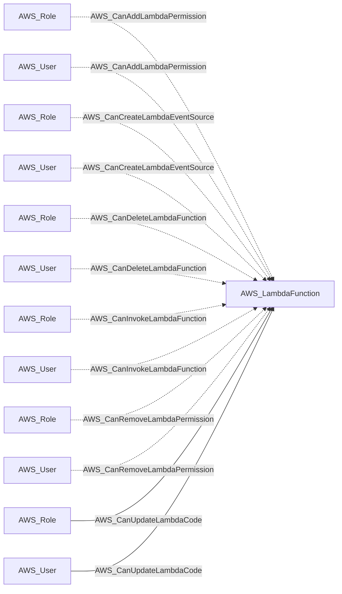
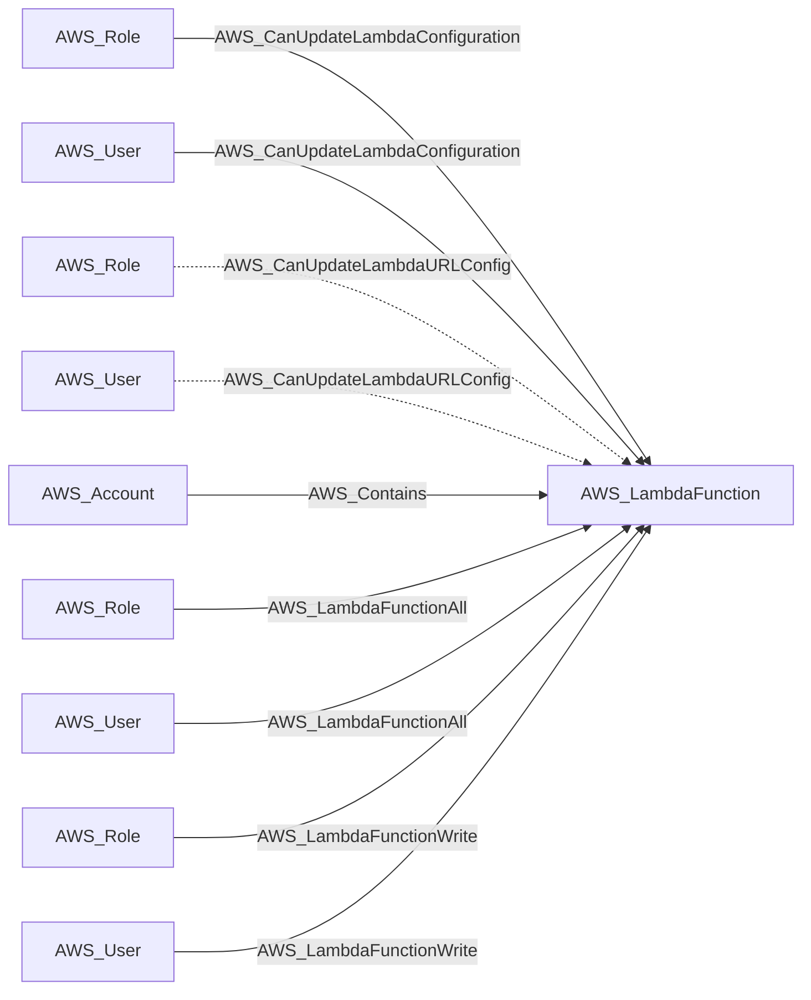
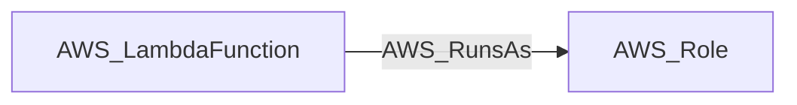

import AwsReferenceBetaNote from '/snippets/opengraph/extensions/aws-reference-beta-note.mdx';

<AwsReferenceBetaNote />

An AWS Lambda function with code, configuration, execution role, and resource policy.

## Identifier

The node identifier is the resource ARN in `arn`.

## Properties

Types below describe collected values. `null` means the value can be unavailable; it does not make the AWS resource optional. Collection scope and API responses determine which metadata is available.

| Property | Type | Description |
| --- | --- | --- |
| `name` | `str` | Collector-generated name used to identify the resource in context. |
| `displayname` | `str` | Resource label shown in the graph. |
| `arn` | `str or null` | AWS Resource Name used as the node identifier. |
| `account_id` | `str or null` | AWS account associated with the resource; nullable in the shared model. |
| `region` | `str or null` | AWS region, or `global` for resources without a regional scope. |
| `environmentid` | `str` | Account root ARN identifying the OpenGraph environment. |
| `runtime` | `str or null` | Lambda runtime identifier. |
| `handler` | `str or null` | Function handler. |
| `role_arn` | `str or null` | IAM execution role ARN. |
| `code_size` | `int or null` | Deployment package size in bytes. |
| `memory_size` | `int or null` | Configured memory size in MB. |
| `timeout` | `int or null` | Function timeout in seconds. |
| `last_modified` | `str or null` | Last modified timestamp from Lambda. |
| `description` | `str or null` | Function description. |
| `has_function_url` | `bool` | Whether a function URL configuration exists. |
| `is_publicly_accessible` | `bool` | Whether the function URL uses no auth. |
| `function_url` | `str or null` | Function URL, when configured. |
| `function_url_auth_type` | `str or null` | Function URL auth type, when configured. |
| `kms_key_arn` | `str or null` | KMS key ARN used by the function, when configured. |
| `layers` | `str or null` | Lambda layer metadata. |
| `resource_policy` | `str or null` | Resource-based Lambda policy, when available. |
| `tags` | `list[str] or null` | Lambda function tags formatted as `key=value` strings. |

## Diagram

Solid arrows show traversable edges; dotted arrows show non-traversable edges. Each view shows the node in relation to the listed endpoint types.

### Inbound edges (1)

### Inbound edges (2)

### Outbound edges

## Edges

These tables cover relationships emitted for this kind by the AWS collector. Other extensions can define additional relationships.

### Inbound Edges

| Edge Type | Source Node Types | Traversable |
| --- | --- | --- |
| [AWS_CanAddLambdaPermission](/opengraph/extensions/aws/edges/aws_canaddlambdapermission) | [AWS_Role](/opengraph/extensions/aws/nodes/aws_role), [AWS_User](/opengraph/extensions/aws/nodes/aws_user) | ❌ |
| [AWS_CanCreateLambdaEventSource](/opengraph/extensions/aws/edges/aws_cancreatelambdaeventsource) | [AWS_Role](/opengraph/extensions/aws/nodes/aws_role), [AWS_User](/opengraph/extensions/aws/nodes/aws_user) | ❌ |
| [AWS_CanDeleteLambdaFunction](/opengraph/extensions/aws/edges/aws_candeletelambdafunction) | [AWS_Role](/opengraph/extensions/aws/nodes/aws_role), [AWS_User](/opengraph/extensions/aws/nodes/aws_user) | ❌ |
| [AWS_CanInvokeLambdaFunction](/opengraph/extensions/aws/edges/aws_caninvokelambdafunction) | [AWS_Role](/opengraph/extensions/aws/nodes/aws_role), [AWS_User](/opengraph/extensions/aws/nodes/aws_user) | ❌ |
| [AWS_CanRemoveLambdaPermission](/opengraph/extensions/aws/edges/aws_canremovelambdapermission) | [AWS_Role](/opengraph/extensions/aws/nodes/aws_role), [AWS_User](/opengraph/extensions/aws/nodes/aws_user) | ❌ |
| [AWS_CanUpdateLambdaCode](/opengraph/extensions/aws/edges/aws_canupdatelambdacode) | [AWS_Role](/opengraph/extensions/aws/nodes/aws_role), [AWS_User](/opengraph/extensions/aws/nodes/aws_user) | ✅ |
| [AWS_CanUpdateLambdaConfiguration](/opengraph/extensions/aws/edges/aws_canupdatelambdaconfiguration) | [AWS_Role](/opengraph/extensions/aws/nodes/aws_role), [AWS_User](/opengraph/extensions/aws/nodes/aws_user) | ✅ |
| [AWS_CanUpdateLambdaURLConfig](/opengraph/extensions/aws/edges/aws_canupdatelambdaurlconfig) | [AWS_Role](/opengraph/extensions/aws/nodes/aws_role), [AWS_User](/opengraph/extensions/aws/nodes/aws_user) | ❌ |
| [AWS_Contains](/opengraph/extensions/aws/edges/aws_contains) | [AWS_Account](/opengraph/extensions/aws/nodes/aws_account) | ✅ |
| [AWS_LambdaFunctionAll](/opengraph/extensions/aws/edges/aws_lambdafunctionall) | [AWS_Role](/opengraph/extensions/aws/nodes/aws_role), [AWS_User](/opengraph/extensions/aws/nodes/aws_user) | ✅ |
| [AWS_LambdaFunctionWrite](/opengraph/extensions/aws/edges/aws_lambdafunctionwrite) | [AWS_Role](/opengraph/extensions/aws/nodes/aws_role), [AWS_User](/opengraph/extensions/aws/nodes/aws_user) | ✅ |

### Outbound Edges

| Edge Type | Destination Node Types | Traversable |
| --- | --- | --- |
| [AWS_RunsAs](/opengraph/extensions/aws/edges/aws_runsas) | [AWS_Role](/opengraph/extensions/aws/nodes/aws_role) | ✅ |

[AWS schema](/opengraph/extensions/aws/schema)
