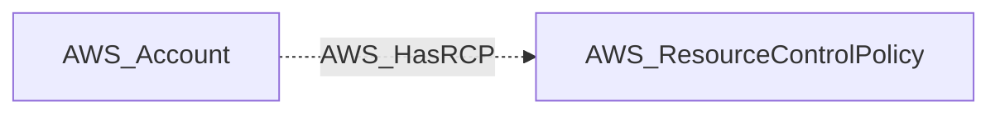

import AwsReferenceBetaNote from '/snippets/opengraph/extensions/aws-reference-beta-note.mdx';

<AwsReferenceBetaNote />

An Organizations RCP that restricts resource-level permissions across member accounts.

## Identifier

The node identifier is the resource ARN in `arn`.

## Properties

Types below describe collected values. `null` means the value can be unavailable; it does not make the AWS resource optional. Collection scope and API responses determine which metadata is available.

| Property | Type | Description |
| --- | --- | --- |
| `name` | `str` | Collector-generated name used to identify the resource in context. |
| `displayname` | `str` | Resource label shown in the graph. |
| `arn` | `str or null` | AWS Resource Name used as the node identifier. |
| `account_id` | `str or null` | AWS account associated with the resource; nullable in the shared model. |
| `region` | `str or null` | AWS region, or `global` for resources without a regional scope. |
| `environmentid` | `str` | Account root ARN identifying the OpenGraph environment. |
| `policy_id` | `str` | AWS Organizations policy ID. |
| `policy_name` | `str` | AWS Organizations policy name. |
| `policy_description` | `str or null` | AWS Organizations policy description. |
| `content` | `str or null` | Raw RCP policy document content. |
| `aws_managed` | `bool` | Whether this is an AWS-managed Organizations policy. |
| `policy_type` | `str or null` | AWS Organizations policy type. |

## Diagram

Solid arrows show traversable edges; dotted arrows show non-traversable edges. Each view shows the node in relation to the listed endpoint types.

### Inbound edges

## Edges

These tables cover relationships emitted for this kind by the AWS collector. Other extensions can define additional relationships.

### Inbound Edges

| Edge Type | Source Node Types | Traversable |
| --- | --- | --- |
| [AWS_HasRCP](/opengraph/extensions/aws/edges/aws_hasrcp) | [AWS_Account](/opengraph/extensions/aws/nodes/aws_account) | ❌ |

### Outbound Edges

No relationships are emitted in this direction for this kind in the current collector.

[AWS schema](/opengraph/extensions/aws/schema)
