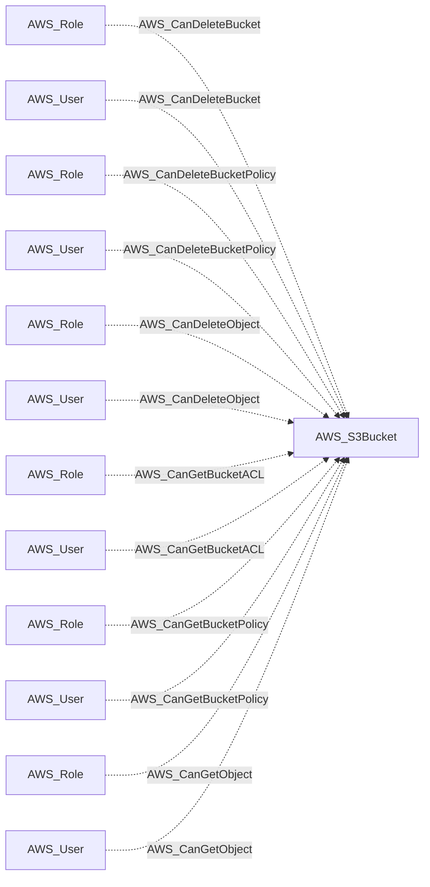
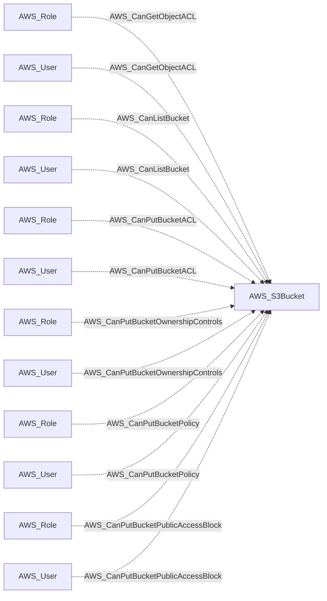
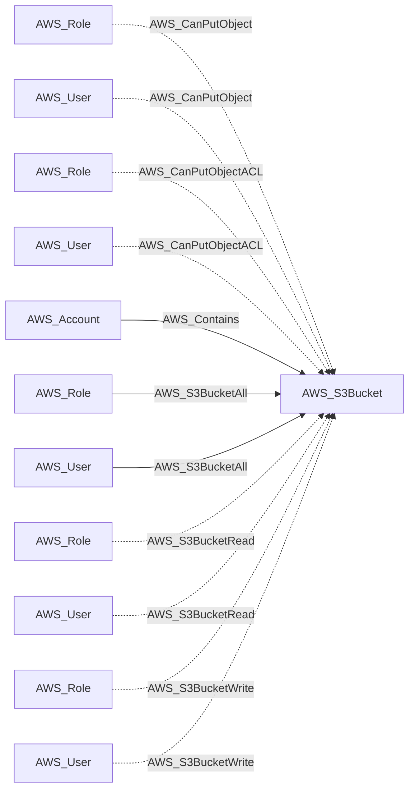
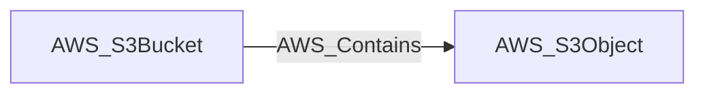

import AwsReferenceBetaNote from '/snippets/opengraph/extensions/aws-reference-beta-note.mdx';

<AwsReferenceBetaNote />

An Amazon S3 bucket with bucket policy, ACL, and public access settings.

## Identifier

The node identifier is the resource ARN in `arn`.

## Properties

Types below describe collected values. `null` means the value can be unavailable; it does not make the AWS resource optional. Collection scope and API responses determine which metadata is available.

| Property | Type | Description |
| --- | --- | --- |
| `name` | `str` | Collector-generated name used to identify the resource in context. |
| `displayname` | `str` | Resource label shown in the graph. |
| `arn` | `str or null` | AWS Resource Name used as the node identifier. |
| `account_id` | `str or null` | AWS account associated with the resource; nullable in the shared model. |
| `region` | `str or null` | AWS region, or `global` for resources without a regional scope. |
| `environmentid` | `str` | Account root ARN identifying the OpenGraph environment. |
| `bucket_name` | `str` | Native S3 bucket name. |
| `creation_date` | `str or null` | Timestamp when the bucket was created. |
| `bucket_policy` | `str or null` | JSON-encoded S3 bucket policy. |
| `acl` | `str or null` | JSON-encoded S3 bucket access control list. |
| `public_access_block` | `str or null` | JSON-encoded bucket public access block configuration. |
| `ownership_controls` | `str or null` | JSON-encoded S3 bucket ownership controls. |
| `tags` | `list[str] or null` | S3 bucket tags formatted as `key=value` strings. |

## Interpretation

An object-operation edge ending at this bucket describes the modeled object namespace. It does not assert permission on every concrete object key. Object collection can also produce edges to individual S3 objects.

## Diagram

Solid arrows show traversable edges; dotted arrows show non-traversable edges. Each view shows the node in relation to the listed endpoint types.

### Inbound edges (1)

### Inbound edges (2)

### Inbound edges (3)

### Inbound edges (4)

```mermaid
graph LR
    n["AWS_S3Bucket"]
    p0_0["AWS_Role"]
    p0_0 -.->|AWS_S3ObjectAll| n
    p0_1["AWS_User"]
    p0_1 -.->|AWS_S3ObjectAll| n
    p1_0["AWS_Role"]
    p1_0 -.->|AWS_S3ObjectRead| n
    p1_1["AWS_User"]
    p1_1 -.->|AWS_S3ObjectRead| n
    p2_0["AWS_Role"]
    p2_0 -.->|AWS_S3ObjectWrite| n
    p2_1["AWS_User"]
    p2_1 -.->|AWS_S3ObjectWrite| n
```

### Outbound edges

## Edges

These tables cover relationships emitted for this kind by the AWS collector. Other extensions can define additional relationships.

### Inbound Edges

| Edge Type | Source Node Types | Traversable |
| --- | --- | --- |
| [AWS_CanDeleteBucket](/opengraph/extensions/aws/edges/aws_candeletebucket) | [AWS_Role](/opengraph/extensions/aws/nodes/aws_role), [AWS_User](/opengraph/extensions/aws/nodes/aws_user) | ❌ |
| [AWS_CanDeleteBucketPolicy](/opengraph/extensions/aws/edges/aws_candeletebucketpolicy) | [AWS_Role](/opengraph/extensions/aws/nodes/aws_role), [AWS_User](/opengraph/extensions/aws/nodes/aws_user) | ❌ |
| [AWS_CanDeleteObject](/opengraph/extensions/aws/edges/aws_candeleteobject) | [AWS_Role](/opengraph/extensions/aws/nodes/aws_role), [AWS_User](/opengraph/extensions/aws/nodes/aws_user) | ❌ |
| [AWS_CanGetBucketACL](/opengraph/extensions/aws/edges/aws_cangetbucketacl) | [AWS_Role](/opengraph/extensions/aws/nodes/aws_role), [AWS_User](/opengraph/extensions/aws/nodes/aws_user) | ❌ |
| [AWS_CanGetBucketPolicy](/opengraph/extensions/aws/edges/aws_cangetbucketpolicy) | [AWS_Role](/opengraph/extensions/aws/nodes/aws_role), [AWS_User](/opengraph/extensions/aws/nodes/aws_user) | ❌ |
| [AWS_CanGetObject](/opengraph/extensions/aws/edges/aws_cangetobject) | [AWS_Role](/opengraph/extensions/aws/nodes/aws_role), [AWS_User](/opengraph/extensions/aws/nodes/aws_user) | ❌ |
| [AWS_CanGetObjectACL](/opengraph/extensions/aws/edges/aws_cangetobjectacl) | [AWS_Role](/opengraph/extensions/aws/nodes/aws_role), [AWS_User](/opengraph/extensions/aws/nodes/aws_user) | ❌ |
| [AWS_CanListBucket](/opengraph/extensions/aws/edges/aws_canlistbucket) | [AWS_Role](/opengraph/extensions/aws/nodes/aws_role), [AWS_User](/opengraph/extensions/aws/nodes/aws_user) | ❌ |
| [AWS_CanPutBucketACL](/opengraph/extensions/aws/edges/aws_canputbucketacl) | [AWS_Role](/opengraph/extensions/aws/nodes/aws_role), [AWS_User](/opengraph/extensions/aws/nodes/aws_user) | ❌ |
| [AWS_CanPutBucketOwnershipControls](/opengraph/extensions/aws/edges/aws_canputbucketownershipcontrols) | [AWS_Role](/opengraph/extensions/aws/nodes/aws_role), [AWS_User](/opengraph/extensions/aws/nodes/aws_user) | ❌ |
| [AWS_CanPutBucketPolicy](/opengraph/extensions/aws/edges/aws_canputbucketpolicy) | [AWS_Role](/opengraph/extensions/aws/nodes/aws_role), [AWS_User](/opengraph/extensions/aws/nodes/aws_user) | ❌ |
| [AWS_CanPutBucketPublicAccessBlock](/opengraph/extensions/aws/edges/aws_canputbucketpublicaccessblock) | [AWS_Role](/opengraph/extensions/aws/nodes/aws_role), [AWS_User](/opengraph/extensions/aws/nodes/aws_user) | ❌ |
| [AWS_CanPutObject](/opengraph/extensions/aws/edges/aws_canputobject) | [AWS_Role](/opengraph/extensions/aws/nodes/aws_role), [AWS_User](/opengraph/extensions/aws/nodes/aws_user) | ❌ |
| [AWS_CanPutObjectACL](/opengraph/extensions/aws/edges/aws_canputobjectacl) | [AWS_Role](/opengraph/extensions/aws/nodes/aws_role), [AWS_User](/opengraph/extensions/aws/nodes/aws_user) | ❌ |
| [AWS_Contains](/opengraph/extensions/aws/edges/aws_contains) | [AWS_Account](/opengraph/extensions/aws/nodes/aws_account) | ✅ |
| [AWS_S3BucketAll](/opengraph/extensions/aws/edges/aws_s3bucketall) | [AWS_Role](/opengraph/extensions/aws/nodes/aws_role), [AWS_User](/opengraph/extensions/aws/nodes/aws_user) | ✅ |
| [AWS_S3BucketRead](/opengraph/extensions/aws/edges/aws_s3bucketread) | [AWS_Role](/opengraph/extensions/aws/nodes/aws_role), [AWS_User](/opengraph/extensions/aws/nodes/aws_user) | ❌ |
| [AWS_S3BucketWrite](/opengraph/extensions/aws/edges/aws_s3bucketwrite) | [AWS_Role](/opengraph/extensions/aws/nodes/aws_role), [AWS_User](/opengraph/extensions/aws/nodes/aws_user) | ❌ |
| [AWS_S3ObjectAll](/opengraph/extensions/aws/edges/aws_s3objectall) | [AWS_Role](/opengraph/extensions/aws/nodes/aws_role), [AWS_User](/opengraph/extensions/aws/nodes/aws_user) | ❌ |
| [AWS_S3ObjectRead](/opengraph/extensions/aws/edges/aws_s3objectread) | [AWS_Role](/opengraph/extensions/aws/nodes/aws_role), [AWS_User](/opengraph/extensions/aws/nodes/aws_user) | ❌ |
| [AWS_S3ObjectWrite](/opengraph/extensions/aws/edges/aws_s3objectwrite) | [AWS_Role](/opengraph/extensions/aws/nodes/aws_role), [AWS_User](/opengraph/extensions/aws/nodes/aws_user) | ❌ |

### Outbound Edges

| Edge Type | Destination Node Types | Traversable |
| --- | --- | --- |
| [AWS_Contains](/opengraph/extensions/aws/edges/aws_contains) | [AWS_S3Object](/opengraph/extensions/aws/nodes/aws_s3object) | ✅ |

[AWS schema](/opengraph/extensions/aws/schema)
