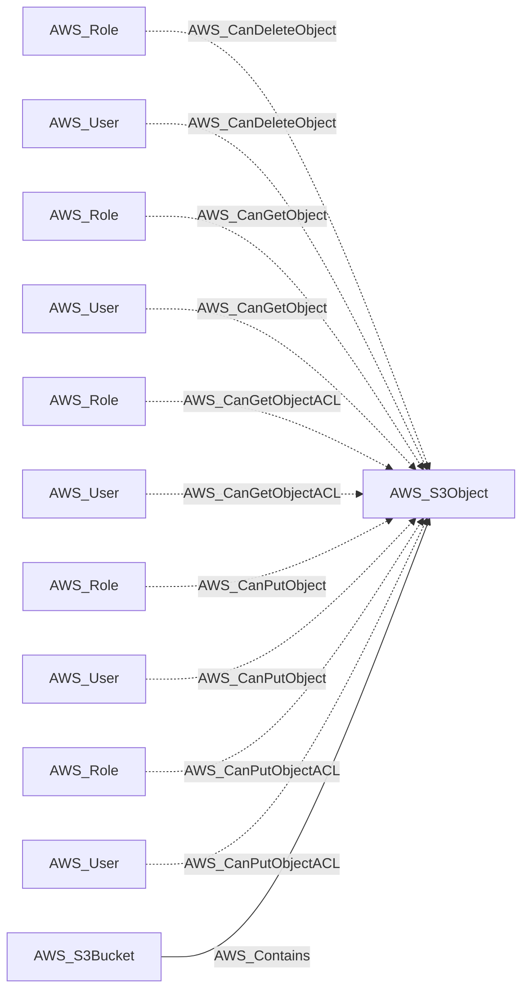
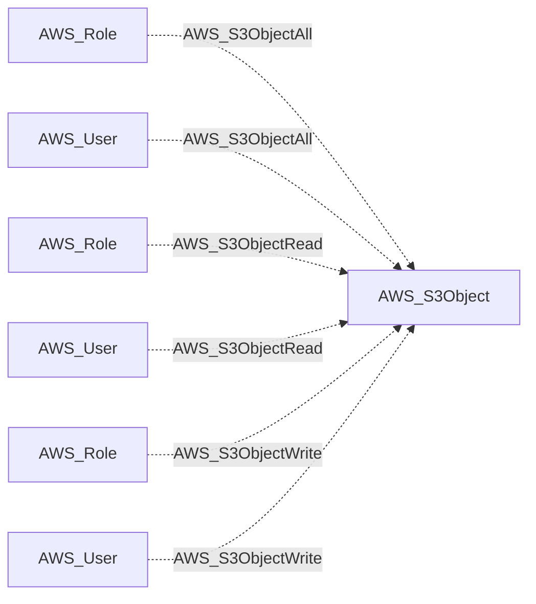

import AwsReferenceBetaNote from '/snippets/opengraph/extensions/aws-reference-beta-note.mdx';

<AwsReferenceBetaNote />

An object (key) stored within an S3 bucket, identified by its s3:::bucket/key ARN and carrying size, storage class, ETag, and last-modified metadata.

## Identifier

The node identifier is the object ARN: `arn:aws:s3:::<bucket>/<key>`. The key is part of the identifier, including any path separators.

## Properties

Types below describe collected values. `null` means the value can be unavailable; it does not make the AWS resource optional. Collection scope and API responses determine which metadata is available.

| Property | Type | Description |
| --- | --- | --- |
| `name` | `str` | Collector-generated name used to identify the resource in context. |
| `displayname` | `str` | Resource label shown in the graph. |
| `arn` | `str or null` | AWS Resource Name used as the node identifier. |
| `account_id` | `str or null` | AWS account associated with the resource; nullable in the shared model. |
| `region` | `str or null` | AWS region, or `global` for resources without a regional scope. |
| `environmentid` | `str` | Account root ARN identifying the OpenGraph environment. |
| `bucket_name` | `str` | S3 bucket containing the object. |
| `bucket_arn` | `str` | ARN of the S3 bucket containing the object. |
| `object_key` | `str` | S3 object key. |
| `last_modified` | `str or null` | Timestamp when the object was last modified. |
| `size` | `int or null` | Object size in bytes. |
| `storage_class` | `str or null` | Object storage class. |
| `etag` | `str or null` | Object ETag. |

## Diagram

Solid arrows show traversable edges; dotted arrows show non-traversable edges. Each view shows the node in relation to the listed endpoint types.

### Inbound edges (1)

### Inbound edges (2)

## Edges

These tables cover relationships emitted for this kind by the AWS collector. Other extensions can define additional relationships.

### Inbound Edges

| Edge Type | Source Node Types | Traversable |
| --- | --- | --- |
| [AWS_CanDeleteObject](/opengraph/extensions/aws/edges/aws_candeleteobject) | [AWS_Role](/opengraph/extensions/aws/nodes/aws_role), [AWS_User](/opengraph/extensions/aws/nodes/aws_user) | ❌ |
| [AWS_CanGetObject](/opengraph/extensions/aws/edges/aws_cangetobject) | [AWS_Role](/opengraph/extensions/aws/nodes/aws_role), [AWS_User](/opengraph/extensions/aws/nodes/aws_user) | ❌ |
| [AWS_CanGetObjectACL](/opengraph/extensions/aws/edges/aws_cangetobjectacl) | [AWS_Role](/opengraph/extensions/aws/nodes/aws_role), [AWS_User](/opengraph/extensions/aws/nodes/aws_user) | ❌ |
| [AWS_CanPutObject](/opengraph/extensions/aws/edges/aws_canputobject) | [AWS_Role](/opengraph/extensions/aws/nodes/aws_role), [AWS_User](/opengraph/extensions/aws/nodes/aws_user) | ❌ |
| [AWS_CanPutObjectACL](/opengraph/extensions/aws/edges/aws_canputobjectacl) | [AWS_Role](/opengraph/extensions/aws/nodes/aws_role), [AWS_User](/opengraph/extensions/aws/nodes/aws_user) | ❌ |
| [AWS_Contains](/opengraph/extensions/aws/edges/aws_contains) | [AWS_S3Bucket](/opengraph/extensions/aws/nodes/aws_s3bucket) | ✅ |
| [AWS_S3ObjectAll](/opengraph/extensions/aws/edges/aws_s3objectall) | [AWS_Role](/opengraph/extensions/aws/nodes/aws_role), [AWS_User](/opengraph/extensions/aws/nodes/aws_user) | ❌ |
| [AWS_S3ObjectRead](/opengraph/extensions/aws/edges/aws_s3objectread) | [AWS_Role](/opengraph/extensions/aws/nodes/aws_role), [AWS_User](/opengraph/extensions/aws/nodes/aws_user) | ❌ |
| [AWS_S3ObjectWrite](/opengraph/extensions/aws/edges/aws_s3objectwrite) | [AWS_Role](/opengraph/extensions/aws/nodes/aws_role), [AWS_User](/opengraph/extensions/aws/nodes/aws_user) | ❌ |

### Outbound Edges

No relationships are emitted in this direction for this kind in the current collector.

[AWS schema](/opengraph/extensions/aws/schema)
