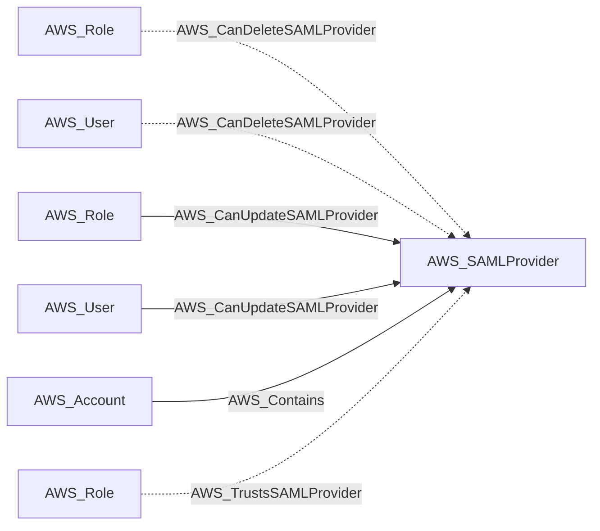
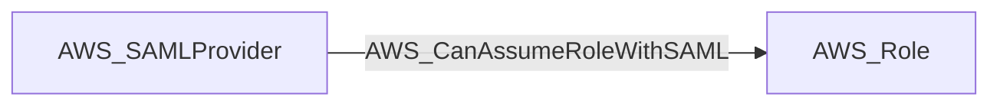

import AwsReferenceBetaNote from '/snippets/opengraph/extensions/aws-reference-beta-note.mdx';

<AwsReferenceBetaNote />

A SAML 2.0 identity provider configured for federated access to AWS.

## Identifier

The node identifier is the resource ARN in `arn`.

## Properties

Types below describe collected values. `null` means the value can be unavailable; it does not make the AWS resource optional. Collection scope and API responses determine which metadata is available.

| Property | Type | Description |
| --- | --- | --- |
| `name` | `str` | Collector-generated name used to identify the resource in context. |
| `displayname` | `str` | Resource label shown in the graph. |
| `arn` | `str or null` | AWS Resource Name used as the node identifier. |
| `account_id` | `str or null` | AWS account associated with the resource; nullable in the shared model. |
| `region` | `str or null` | AWS region, or `global` for resources without a regional scope. |
| `environmentid` | `str` | Account root ARN identifying the OpenGraph environment. |
| `provider_name` | `str` | The provider name derived from the provider ARN. |
| `create_date` | `str or null` | Timestamp when the provider was created. |
| `valid_until` | `str or null` | The optional SAML provider expiration timestamp. |
| `tags` | `list[str] or null` | Optional IAM tags attached to the provider. |

## Diagram

Solid arrows show traversable edges; dotted arrows show non-traversable edges. Each view shows the node in relation to the listed endpoint types.

### Inbound edges

### Outbound edges

## Edges

These tables cover relationships emitted for this kind by the AWS collector. Other extensions can define additional relationships.

### Inbound Edges

| Edge Type | Source Node Types | Traversable |
| --- | --- | --- |
| [AWS_CanDeleteSAMLProvider](/opengraph/extensions/aws/edges/aws_candeletesamlprovider) | [AWS_Role](/opengraph/extensions/aws/nodes/aws_role), [AWS_User](/opengraph/extensions/aws/nodes/aws_user) | ❌ |
| [AWS_CanUpdateSAMLProvider](/opengraph/extensions/aws/edges/aws_canupdatesamlprovider) | [AWS_Role](/opengraph/extensions/aws/nodes/aws_role), [AWS_User](/opengraph/extensions/aws/nodes/aws_user) | ✅ |
| [AWS_Contains](/opengraph/extensions/aws/edges/aws_contains) | [AWS_Account](/opengraph/extensions/aws/nodes/aws_account) | ✅ |
| [AWS_TrustsSAMLProvider](/opengraph/extensions/aws/edges/aws_trustssamlprovider) | [AWS_Role](/opengraph/extensions/aws/nodes/aws_role) | ❌ |

### Outbound Edges

| Edge Type | Destination Node Types | Traversable |
| --- | --- | --- |
| [AWS_CanAssumeRoleWithSAML](/opengraph/extensions/aws/edges/aws_canassumerolewithsaml) | [AWS_Role](/opengraph/extensions/aws/nodes/aws_role) | ✅ |

[AWS schema](/opengraph/extensions/aws/schema)
