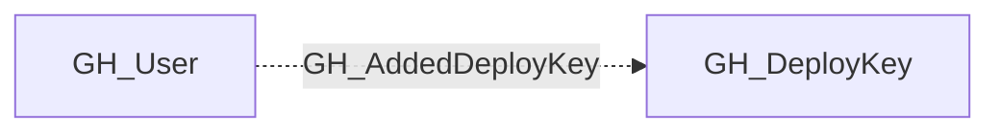

## Edge Schema

- Traversable: ❌

| Source | Destination |
| --- | --- |
| [GH_User](/opengraph/extensions/github/nodes/gh_user) | [GH_DeployKey](/opengraph/extensions/github/nodes/gh_deploykey) |

## General Information

User added this repository deploy key.

## Diagram

## References

- [Deployment environments API](https://docs.github.com/en/rest/deployments/environments)
