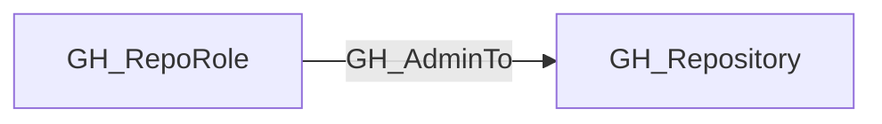

## Edge Schema

- Traversable: ✅

| Source | Destination |
| --- | --- |
| [GH_RepoRole](/opengraph/extensions/github/nodes/gh_reporole) | [GH_Repository](/opengraph/extensions/github/nodes/gh_repository) |

## General Information

The traversable GH_AdminTo edge represents a role's full administrative access to the repository. Admin is the highest built-in repository role and grants control over all repository settings, including dangerous operations like deleting the repository or modifying its visibility. Classic branch protection may exempt administrators unless administrator enforcement is enabled; repository rulesets and enterprise policy can impose additional constraints. This edge is a key permission in the computed branch access model and is a high-value target in attack path analysis.

## Diagram



## Abuse Info

An actor holding the source repository admin role can administer the destination repository. Branch rules that apply to administrators, repository rulesets and enterprise policies can still constrain specific operations.

Abuse using GitHub UI:

Open the repository Settings and its access-management view as the controlled principal. Review applicable rules before choosing an authorized administrative operation.

Abuse using API:

1. Authenticate in the source context and set the exact destination identifiers. These examples require Bash, curl and jq. URL-encode path values that contain reserved characters. Use the configured server API root for GitHub Enterprise Server.

```bash
set -euo pipefail
export GITHUB_API="https://api.github.com"
export GITHUB_TOKEN="REPLACE_WITH_AUTHORIZED_TOKEN"
export OWNER="controlled-org"
export REPO="controlled-repo"
export USERNAME="controlled-user"
api() {
  curl --fail-with-body -sS \
    -H "Authorization: Bearer $GITHUB_TOKEN" \
    -H "Accept: application/vnd.github+json" \
    -H "X-GitHub-Api-Version: 2022-11-28" \
    "$GITHUB_API$1"
}
```

2. Check the source grant or execution context. Successful JSON reads return HTTP 200; authorization failures do not validate the path.

```bash
api "/repos/$OWNER/$REPO/collaborators/$USERNAME/permission" | jq '{permission,role_name}'
```

3. Verify the destination or adjacent control, then interpret the result within the edge's scope. Paginated listings require following all pages when used for complete coverage.

```bash
api "/repos/$OWNER/$REPO" | jq '{full_name,permissions}'
```

Confirm permission=admin for the principal and permissions.admin=true for the current credential where available. This verifies existing administration without deleting the repository or weakening protections. A token must also have endpoint-specific permissions; account role alone does not grant every token operation.

## Opsec Considerations

Repository administration changes appear in organization audit logs; Git pushes and workflow changes also leave commit and Actions history. Metadata read success alone does not prove every administrative operation would succeed.

## References

- [Repository roles](https://docs.github.com/en/organizations/managing-access-to-your-organizations-repositories/repository-roles-for-an-organization)
- [Branch protection API](https://docs.github.com/en/rest/branches/branch-protection)
