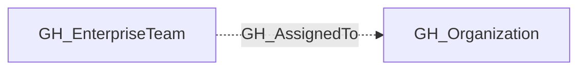

## Edge Schema

- Traversable: ❌

| Source | Destination |
| --- | --- |
| [GH_EnterpriseTeam](/opengraph/extensions/github/nodes/gh_enterpriseteam) | [GH_Organization](/opengraph/extensions/github/nodes/gh_organization) |

## General Information

The non-traversable GH_AssignedTo edge represents an enterprise-scoped team being assigned to an organization.

This edge is not traversable because assignment alone does not directly grant a principal a privilege path.

## Diagram

## References

- [Repository roles](https://docs.github.com/en/organizations/managing-access-to-your-organizations-repositories/repository-roles-for-an-organization)
