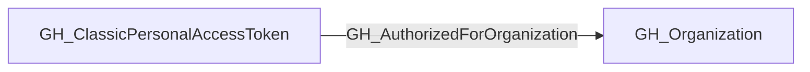

## Edge Schema

- Traversable: ❌

| Start | Kind | End |
|-------|-----------|-------|
| [GH_ClassicPersonalAccessToken](/opengraph/extensions/github/nodes/gh_classicpersonalaccesstoken) | GH_AuthorizedForOrganization | [GH_Organization](/opengraph/extensions/github/nodes/gh_organization) |

## General Information

Classic personal access token has a recorded authorization for this organization.

## Edge Schema

| Source | Destination | Traversable |
| --- | --- | --- |
| [GH_ClassicPersonalAccessToken](/opengraph/extensions/github/nodes/gh_classicpersonalaccesstoken) | [GH_Organization](/opengraph/extensions/github/nodes/gh_organization) | `false` |

## Diagram

