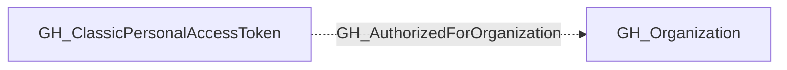

## Edge Schema

- Traversable: ❌

| Source | Destination |
| --- | --- |
| [GH_ClassicPersonalAccessToken](/opengraph/extensions/github/nodes/gh_classicpersonalaccesstoken) | [GH_Organization](/opengraph/extensions/github/nodes/gh_organization) |

## General Information

Classic personal access token has a recorded authorization for this organization.

## Diagram

## References

- [Organization roles](https://docs.github.com/en/organizations/managing-peoples-access-to-your-organization-with-roles/roles-in-an-organization)
- [Custom organization role API](https://docs.github.com/en/enterprise-cloud@latest/rest/orgs/organization-roles)
