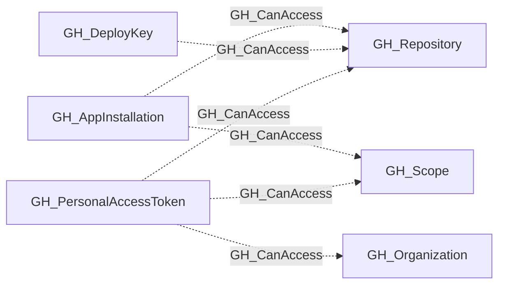

## Edge Schema

- Traversable: ❌

| Source | Destination |
| --- | --- |
| [GH_AppInstallation](/opengraph/extensions/github/nodes/gh_appinstallation) | [GH_Repository](/opengraph/extensions/github/nodes/gh_repository) |
| [GH_AppInstallation](/opengraph/extensions/github/nodes/gh_appinstallation) | [GH_Scope](/opengraph/extensions/github/nodes/gh_scope) |
| [GH_DeployKey](/opengraph/extensions/github/nodes/gh_deploykey) | [GH_Repository](/opengraph/extensions/github/nodes/gh_repository) |
| [GH_PersonalAccessToken](/opengraph/extensions/github/nodes/gh_personalaccesstoken) | [GH_Organization](/opengraph/extensions/github/nodes/gh_organization) |
| [GH_PersonalAccessToken](/opengraph/extensions/github/nodes/gh_personalaccesstoken) | [GH_Repository](/opengraph/extensions/github/nodes/gh_repository) |
| [GH_PersonalAccessToken](/opengraph/extensions/github/nodes/gh_personalaccesstoken) | [GH_Scope](/opengraph/extensions/github/nodes/gh_scope) |

## General Information

The non-traversable GH_CanAccess edge indicates that a personal access token, app installation, or deploy key has been granted access to a repository, reusable scope, or organization. All-repository app installations and PATs point to an organization-scoped [GH_Scope](/opengraph/extensions/github/nodes/gh_scope) with `scope_type=repository` instead of repeating an edge to every repository. This edge represents access scope rather than a direct attack path.

## Diagram

## References

- [Personal access token API](https://docs.github.com/en/rest/orgs/personal-access-tokens)
- [GitHub App installations API](https://docs.github.com/en/rest/apps/installations)
