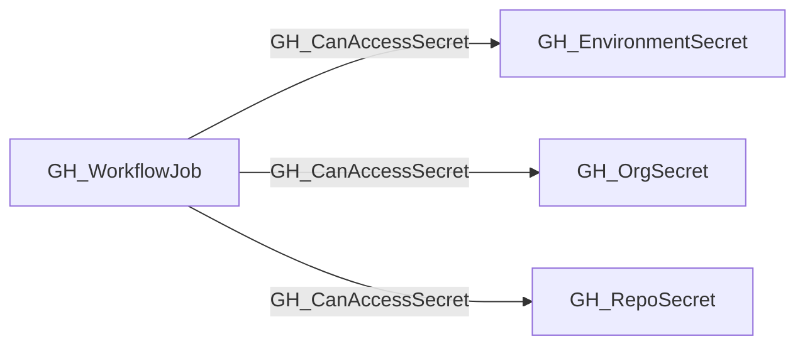

## Edge Schema

- Traversable: ✅

| Source | Destination |
| --- | --- |
| [GH_WorkflowJob](/opengraph/extensions/github/nodes/gh_workflowjob) | [GH_EnvironmentSecret](/opengraph/extensions/github/nodes/gh_environmentsecret) |
| [GH_WorkflowJob](/opengraph/extensions/github/nodes/gh_workflowjob) | [GH_OrgSecret](/opengraph/extensions/github/nodes/gh_orgsecret) |
| [GH_WorkflowJob](/opengraph/extensions/github/nodes/gh_workflowjob) | [GH_RepoSecret](/opengraph/extensions/github/nodes/gh_reposecret) |

## General Information

The traversable GH_CanAccessSecret edge represents that a GitHub Actions workflow job execution context can access a statically referenced secret.

This edge is derived from the existing non-traversable [GH_UsesSecret](/opengraph/extensions/github/edges/gh_usessecret) relationships on the job's contained steps and from job-level `env` declarations. It is intended for attack-path analysis from a compromised job execution context to the secrets that context can read.

The collector only emits this edge when one of the workflow job's modeled steps or the job's `env` block statically references the secret. The existence of a secret in the repository, organization, or environment scope alone is not enough. For this initial implementation, secrets passed through `jobs.<job_id>.secrets` to reusable workflows are retained as structural references but are not projected as runtime access for the caller job.

## Diagram



## Abuse Info

Control of a job's executing process can expose statically referenced secrets that are available in that run. The edge is computed from job/step references and scope, not from a recorded plaintext read.

Abuse using GitHub UI:

Inspect the job's workflow definition, repository/organization secret availability and any environment protection. A referenced secret can be unavailable to a forked or gated run.

Abuse using API:

1. Authenticate in the source context and set the exact destination identifiers. These examples require Bash, curl and jq. URL-encode path values that contain reserved characters. Use the configured server API root for GitHub Enterprise Server.

```bash
set -euo pipefail
export GITHUB_API="https://api.github.com"
export GITHUB_TOKEN="REPLACE_WITH_AUTHORIZED_TOKEN"
export OWNER="controlled-org"
export REPO="controlled-repo"
export JOB_ID="1"
export SECRET_NAME="CONTROLLED_CANARY"
api() {
  curl --fail-with-body -sS \
    -H "Authorization: Bearer $GITHUB_TOKEN" \
    -H "Accept: application/vnd.github+json" \
    -H "X-GitHub-Api-Version: 2022-11-28" \
    "$GITHUB_API$1"
}
```

2. Check the source grant or execution context. Successful JSON reads return HTTP 200; authorization failures do not validate the path.

```bash
api "/repos/$OWNER/$REPO/actions/jobs/$JOB_ID" | jq '{id,name,run_id,status,conclusion}'
```

3. Verify the destination or adjacent control, then interpret the result within the edge's scope. Paginated listings require following all pages when used for complete coverage.

```bash
api "/repos/$OWNER/$REPO/actions/secrets/$SECRET_NAME" | jq '{name,created_at,updated_at}'
```

Use the matching organization/environment secret endpoint for those destinations. Confirm the job's YAML reference and runtime environment gate. Validate execution only with a controlled canary already approved for the test; successful metadata retrieval does not establish plaintext access.

## Opsec Considerations

Actions job logs and host telemetry show execution. Never output a real secret or reversible encoding to demonstrate the path. Audit secret configuration changes separately from execution-context access.

## References

- [Actions secrets API](https://docs.github.com/en/rest/actions/secrets)
- [Workflow jobs API](https://docs.github.com/en/rest/actions/workflow-jobs)
- [Secure use of GitHub Actions](https://docs.github.com/en/actions/reference/security/secure-use)
