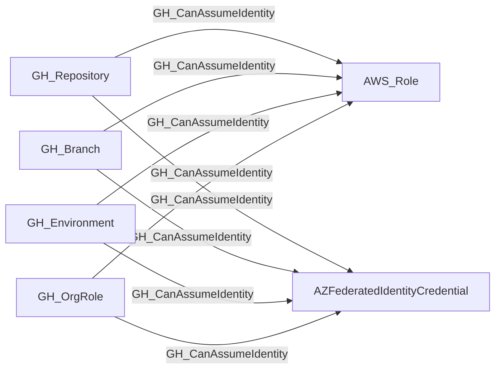

## Edge Schema

- Traversable: ✅

| Source | Destination |
| --- | --- |
| [GH_Branch](/opengraph/extensions/github/nodes/gh_branch) | `AWS_Role` |
| [GH_Branch](/opengraph/extensions/github/nodes/gh_branch) | `AZFederatedIdentityCredential` |
| [GH_Environment](/opengraph/extensions/github/nodes/gh_environment) | `AWS_Role` |
| [GH_Environment](/opengraph/extensions/github/nodes/gh_environment) | `AZFederatedIdentityCredential` |
| [GH_OrgRole](/opengraph/extensions/github/nodes/gh_orgrole) | `AWS_Role` |
| [GH_OrgRole](/opengraph/extensions/github/nodes/gh_orgrole) | `AZFederatedIdentityCredential` |
| [GH_Repository](/opengraph/extensions/github/nodes/gh_repository) | `AWS_Role` |
| [GH_Repository](/opengraph/extensions/github/nodes/gh_repository) | `AZFederatedIdentityCredential` |

## General Information

The traversable GH_CanAssumeIdentity edge is a hybrid edge connecting GitHub OIDC token sources to cloud identity targets configured for GitHub Actions federation. This edge represents a proposed or externally correlated federation path; live acceptance depends on the downstream trust and the run context. It is traversable because an attacker who can execute workflows in the source repository, branch, or environment may obtain an OIDC token; issuer, subject, audience and downstream policy must all match before that token grants cloud access. This edge is critical for identifying cross-cloud lateral movement paths from GitHub into Azure and AWS.

## Diagram



## Abuse Info

This hybrid relationship requires both control of the GitHub workflow execution context and an independently verified downstream cloud trust. It is not emitted by the GitHub collector's ordinary model registrations. A matching identity string alone is insufficient to establish a working token exchange.

Abuse using GitHub UI:

Inspect the Actions run and the destination cloud federation configuration side by side. Confirm the owner of the hybrid correlation and the exact source/destination kinds before treating this as a usable path.

Abuse using API:

1. Authenticate in the source context and set the exact destination identifiers. These examples require Bash, curl and jq. URL-encode path values that contain reserved characters. Use the configured server API root for GitHub Enterprise Server.

```bash
set -euo pipefail
export GITHUB_API="https://api.github.com"
export GITHUB_TOKEN="REPLACE_WITH_AUTHORIZED_TOKEN"
export OWNER="controlled-org"
export REPO="controlled-repo"
export RUN_ID="1"
export JOB_ID="1"
api() {
  curl --fail-with-body -sS \
    -H "Authorization: Bearer $GITHUB_TOKEN" \
    -H "Accept: application/vnd.github+json" \
    -H "X-GitHub-Api-Version: 2022-11-28" \
    "$GITHUB_API$1"
}
```

2. Check the source grant or execution context. Successful JSON reads return HTTP 200; authorization failures do not validate the path.

```bash
api "/repos/$OWNER/$REPO/actions/runs/$RUN_ID" | jq '{id,event,head_branch,status,conclusion}'
```

3. Verify the destination or adjacent control, then interpret the result within the edge's scope. Paginated listings require following all pages when used for complete coverage.

```bash
api "/repos/$OWNER/$REPO/actions/jobs/$JOB_ID" | jq '{id,name,run_id,conclusion}'
```

Inspect the workflow/job id-token permission and, inside the authorized job, the GitHub OIDC issuer, audience and subject. Use the destination cloud's documented token-exchange tooling with its exact tenant/account, client/role and audience; then verify the resulting caller identity there. No universal GitHub REST endpoint performs that exchange. Cloud-specific exchange/restoration details require the owning hybrid extension and are not validated by these metadata reads.

## Opsec Considerations

Correlate GitHub job IDs and OIDC claims with destination cloud sign-in/token exchange logs. Metadata correlation does not prove cloud access.

## References

- [OpenID Connect in GitHub Actions](https://docs.github.com/en/actions/concepts/security/openid-connect)
- [GitHub OIDC claims and token permissions](https://docs.github.com/en/actions/reference/security/oidc)
- [Workflow jobs API](https://docs.github.com/en/rest/actions/workflow-jobs)
- [AWS role trust for GitHub OIDC](https://docs.aws.amazon.com/IAM/latest/UserGuide/id_roles_create_for-idp_oidc.html)
- [Microsoft Entra workload identity federation](https://learn.microsoft.com/en-us/entra/workload-id/workload-identity-federation)
