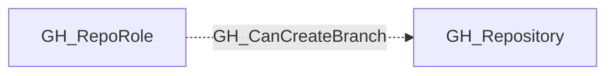

## Edge Schema

- Traversable: ✅

| Source | Destination |
| --- | --- |
| [GH_RepoRole](/opengraph/extensions/github/nodes/gh_reporole) | [GH_Repository](/opengraph/extensions/github/nodes/gh_repository) |

## General Information

The traversable GH_CanCreateBranch edge is a computed edge indicating that a role or actor can create new branches in a repository. The computation evaluates whether a wildcard (`*`) BPR with push restrictions and `blocks_creations` exists. If no such BPR exists, any write-capable role can create branches. If one exists, admin or `push_protected_branch` permission is required, or the actor must be listed in pushAllowances. Per-actor edges from [GH_User](/opengraph/extensions/github/nodes/gh_user) or [GH_Team](/opengraph/extensions/github/nodes/gh_team) are only emitted when BPR allowances grant branch creation access beyond what the role provides. Each edge includes a `reason` property and a `query_composition` Cypher query showing the underlying graph evidence.

## Scenarios

### `no_protection` — No wildcard BPR blocking creations

No wildcard (`*`) BPR with `blocks_creations` exists. Any write-capable role can create new branches.

## Diagram



## Abuse Info

A principal holding the source repository role may create a branch that satisfies the modeled creation constraints. A new ref does not guarantee workflow execution: rulesets, token workflow permissions, Actions policy and trigger configuration still apply.

Abuse using GitHub UI:

Review repository Rules and Actions settings before creating a uniquely named controlled branch through the normal branch selector. The graph predicts capability from the collected policies.

Abuse using API:

1. Authenticate in the source context and set the exact destination identifiers. These examples require Bash, curl and jq. URL-encode path values that contain reserved characters. Use the configured server API root for GitHub Enterprise Server.

```bash
set -euo pipefail
export GITHUB_API="https://api.github.com"
export GITHUB_TOKEN="REPLACE_WITH_AUTHORIZED_TOKEN"
export OWNER="controlled-org"
export REPO="controlled-repo"
export BRANCH="main"
api() {
  curl --fail-with-body -sS \
    -H "Authorization: Bearer $GITHUB_TOKEN" \
    -H "Accept: application/vnd.github+json" \
    -H "X-GitHub-Api-Version: 2022-11-28" \
    "$GITHUB_API$1"
}
```

2. Check the source grant or execution context. Successful JSON reads return HTTP 200; authorization failures do not validate the path.

```bash
api "/repos/$OWNER/$REPO/git/ref/heads/$BRANCH" | jq '{ref,object}'
```

3. Verify the destination or adjacent control, then interpret the result within the edge's scope. Paginated listings require following all pages when used for complete coverage.

```bash
api "/repos/$OWNER/$REPO/actions/workflows?per_page=100" | jq '.workflows[]|{id,path,state}'
```

Inspect a controlled existing ref and the workflows applicable to it. A complete live validation needs a unique test branch, a permitted ref-creation request and a read-back of its SHA; the verification reads here deliberately make no new ref. Do not confuse raw [GH_WriteRepoContents](/opengraph/extensions/github/edges/gh_writerepocontents) with the computed creation decision.

## Opsec Considerations

Branch creation and subsequent commits/workflow runs create repository activity and Actions history. A metadata read does not validate those state changes.

## References

- [Git references API](https://docs.github.com/en/rest/git/refs)
- [Branch protection API](https://docs.github.com/en/rest/branches/branch-protection)
