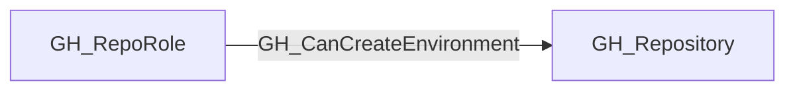

## Edge Schema

- Traversable: ✅

| Source | Destination |
| --- | --- |
| [GH_RepoRole](/opengraph/extensions/github/nodes/gh_reporole) | [GH_Repository](/opengraph/extensions/github/nodes/gh_repository) |

## General Information

The traversable GH_CanCreateEnvironment edge is a computed edge indicating that a repository role can cause a new GitHub environment to be created in the repository. This is derived from the ability to create and modify runnable branches/workflows: if a workflow references an environment name that does not already exist, GitHub will create that environment automatically.

This edge is useful for modeling OIDC and deployment scenarios where trust is tied to an environment name. An attacker who can create a new environment through workflow changes may be able to instantiate a trusted environment on demand, even if it was not previously configured.

## Diagram



## Abuse Info

A role that can introduce and execute a workflow can cause a previously nonexistent environment name to be created. This differs from directly administering environments through the environment REST API, which requires repository administration.

Abuse using GitHub UI:

Inspect repository Actions and Settings > Environments. Confirm the environment name was absent before any authorized workflow test and record the workflow/ref responsible for creating it.

Abuse using API:

1. Authenticate in the source context and set the exact destination identifiers. These examples require Bash, curl and jq. URL-encode path values that contain reserved characters. Use the configured server API root for GitHub Enterprise Server.

```bash
set -euo pipefail
export GITHUB_API="https://api.github.com"
export GITHUB_TOKEN="REPLACE_WITH_AUTHORIZED_TOKEN"
export OWNER="controlled-org"
export REPO="controlled-repo"
export ENVIRONMENT="controlled-canary"
api() {
  curl --fail-with-body -sS \
    -H "Authorization: Bearer $GITHUB_TOKEN" \
    -H "Accept: application/vnd.github+json" \
    -H "X-GitHub-Api-Version: 2022-11-28" \
    "$GITHUB_API$1"
}
```

2. Check the source grant or execution context. Successful JSON reads return HTTP 200; authorization failures do not validate the path.

```bash
api "/repos/$OWNER/$REPO/actions/workflows?per_page=100" | jq '.workflows[]|{id,path,state}'
```

3. Verify the destination or adjacent control, then interpret the result within the edge's scope. Paginated listings require following all pages when used for complete coverage.

```bash
api "/repos/$OWNER/$REPO/environments/$ENVIRONMENT" | jq '{id,name,protection_rules,deployment_branch_policy}'
```

For a controlled execution, a job must reference environment: <the controlled name> and run through an allowed trigger/branch. Verify that the previously absent environment now exists. These requests inspect existing state; they do not demonstrate that workflow-write or execution gates passed. A matching cloud trust is an additional prerequisite.

## Opsec Considerations

Workflow commits, run/deployment logs and environment creation activity form the trail. An environment name alone is not evidence of token issuance or cloud access.

## References

- [Deployment environments API](https://docs.github.com/en/rest/deployments/environments)
- [Secure use of GitHub Actions](https://docs.github.com/en/actions/reference/security/secure-use)
