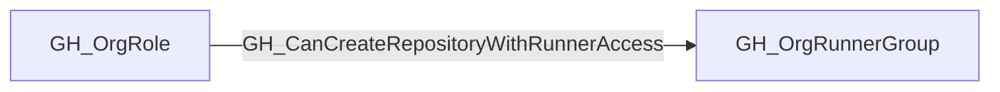

## Edge Schema

- Traversable: ✅

| Source | Destination |
| --- | --- |
| [GH_OrgRole](/opengraph/extensions/github/nodes/gh_orgrole) | [GH_OrgRunnerGroup](/opengraph/extensions/github/nodes/gh_orgrunnergroup) |

## General Information

The traversable GH_CanCreateRepositoryWithRunnerAccess edge is a computed edge indicating that a [GH_OrgRole](/opengraph/extensions/github/nodes/gh_orgrole) can create a repository that will immediately be able to dispatch workflows to a [GH_OrgRunnerGroup](/opengraph/extensions/github/nodes/gh_orgrunnergroup).

This edge is emitted only for runner groups with `visibility=all` or `visibility=private`. Groups with `visibility=selected` require explicit repository assignment, so creating a repository does not automatically grant access to the group. For `visibility=all`, public repository creation is included only when `allows_public_repositories=true`; otherwise the composition is limited to private and internal repository creation.

The collector emits this edge only when new repositories in the organization have GitHub Actions enabled by default (`actions_enabled_repositories=all`), the organization-facing runner group has `restricted_to_workflows=false`, and inherited enterprise-backed access also has `restricted_to_workflows=false` on the source [GH_EnterpriseRunnerGroup](/opengraph/extensions/github/nodes/gh_enterpriserunnergroup).

The computation follows repository-creation capability edges from the org role to the organization and then [GH_Contains](/opengraph/extensions/github/edges/gh_contains) to the runner group. Each edge includes a `query_composition` Cypher query showing the repository-creation path and the Actions and runner-group policy predicates that make the path immediately usable.

## Diagram



## Abuse Info

A source organization role with a matching repository-creation capability may create a repository eligible for the destination runner group. The group's visibility, public-repository allowance and workflow restrictions still determine usable access.

Abuse using GitHub UI:

Review organization repository-creation policy and the runner group's repository/workflow access settings. Confirm that the proposed visibility satisfies both policies before an authorized repository-creation test.

Abuse using API:

1. Authenticate in the source context and set the exact destination identifiers. These examples require Bash, curl and jq. URL-encode path values that contain reserved characters. Use the configured server API root for GitHub Enterprise Server.

```bash
set -euo pipefail
export GITHUB_API="https://api.github.com"
export GITHUB_TOKEN="REPLACE_WITH_AUTHORIZED_TOKEN"
export OWNER="controlled-org"
export REPO="controlled-repo"
export GROUP_ID="1"
api() {
  curl --fail-with-body -sS \
    -H "Authorization: Bearer $GITHUB_TOKEN" \
    -H "Accept: application/vnd.github+json" \
    -H "X-GitHub-Api-Version: 2022-11-28" \
    "$GITHUB_API$1"
}
```

2. Check the source grant or execution context. Successful JSON reads return HTTP 200; authorization failures do not validate the path.

```bash
api "/orgs/$OWNER/actions/runner-groups/$GROUP_ID" | jq '{id,visibility,allows_public_repositories,restricted_to_workflows,selected_workflows}'
```

3. Verify the destination or adjacent control, then interpret the result within the edge's scope. Paginated listings require following all pages when used for complete coverage.

```bash
api "/repos/$OWNER/$REPO" | jq '{full_name,visibility,permissions}'
```

Check the source role's allowed creation visibility and the runner group scope together. Selected-repository membership is not automatically granted merely by creating a repository. The commands inspect a controlled repository; they do not create one or establish a successful runner dispatch.

## Opsec Considerations

Repository creation and runner-group changes are auditable. A subsequent controlled dispatch leaves Actions job and runner logs. Keep creation and execution evidence separate.

## References

- [Organization roles](https://docs.github.com/en/organizations/managing-peoples-access-to-your-organization-with-roles/roles-in-an-organization)
- [Self-hosted runner groups API](https://docs.github.com/en/rest/actions/self-hosted-runner-groups)
