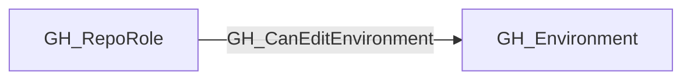

## Edge Schema

- Traversable: ✅

| Source | Destination |
| --- | --- |
| [GH_RepoRole](/opengraph/extensions/github/nodes/gh_reporole) | [GH_Environment](/opengraph/extensions/github/nodes/gh_environment) |

## General Information

The traversable GH_CanEditEnvironment edge indicates that a repository role can modify the configuration of a GitHub environment. In the current model, this edge is emitted for the repository's built-in `admin` role to every environment contained in that repository.

Editing an environment is security-relevant because environment configuration controls deployment protections such as required reviewers, self-review restrictions, wait timers, deployment branch policies, and the "allow administrators to bypass configured protection rules" setting. An attacker who can edit an environment may be able to weaken or remove those controls, making later deployment and secret access paths possible.

This edge is distinct from [GH_CanDeployToEnvironment](/opengraph/extensions/github/edges/gh_candeploytoenvironment):

- **GH_CanEditEnvironment** means the role can manage the environment's settings.
- **[GH_CanDeployToEnvironment](/opengraph/extensions/github/edges/gh_candeploytoenvironment)** means the source satisfies the modeled deployment policy, reviewer gate, or administrator bypass condition for the environment.

## Diagram



## Abuse Info

A source repository admin role can administer the destination environment's protection configuration. That capability can enable later deployment paths, but it is distinct from an already approved deployment.

Abuse using GitHub UI:

Open repository Settings > Environments and inspect the destination environment's deployment protections. Avoid weakening a production gate merely to demonstrate an existing administrative relationship.

Abuse using API:

1. Authenticate in the source context and set the exact destination identifiers. These examples require Bash, curl and jq. URL-encode path values that contain reserved characters. Use the configured server API root for GitHub Enterprise Server.

```bash
set -euo pipefail
export GITHUB_API="https://api.github.com"
export GITHUB_TOKEN="REPLACE_WITH_AUTHORIZED_TOKEN"
export OWNER="controlled-org"
export REPO="controlled-repo"
export ENVIRONMENT="controlled-canary"
api() {
  curl --fail-with-body -sS \
    -H "Authorization: Bearer $GITHUB_TOKEN" \
    -H "Accept: application/vnd.github+json" \
    -H "X-GitHub-Api-Version: 2022-11-28" \
    "$GITHUB_API$1"
}
```

2. Check the source grant or execution context. Successful JSON reads return HTTP 200; authorization failures do not validate the path.

```bash
api "/repos/$OWNER/$REPO/environments/$ENVIRONMENT" | jq '{id,name,protection_rules,deployment_branch_policy,can_admins_bypass}'
```

3. Verify the destination or adjacent control, then interpret the result within the edge's scope. Paginated listings require following all pages when used for complete coverage.

```bash
api "/repos/$OWNER/$REPO" | jq '{full_name,permissions}'
```

Confirm repository administration and inspect reviewer/self-review, bypass and branch-policy configuration. Endpoint-specific token permissions remain necessary. The examples read existing settings; a live change test must preserve and restore the full writable configuration rather than PUT the unfiltered GET response.

## Opsec Considerations

Environment setting changes appear in audit logs and can affect pending/future jobs. Deployment approvals and run logs must be correlated separately from environment administration.

## References

- [Deployment environments API](https://docs.github.com/en/rest/deployments/environments)
- [Repository roles](https://docs.github.com/en/organizations/managing-access-to-your-organizations-repositories/repository-roles-for-an-organization)
