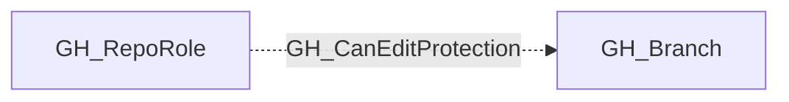

## Edge Schema

- Traversable: ✅

| Source | Destination |
| --- | --- |
| [GH_RepoRole](/opengraph/extensions/github/nodes/gh_reporole) | [GH_Branch](/opengraph/extensions/github/nodes/gh_branch) |

## General Information

The traversable GH_CanEditProtection edge is a computed edge indicating that a role can modify or remove branch protection rules in a repository. This edge is emitted when the role has [GH_EditRepoProtections](/opengraph/extensions/github/edges/gh_editrepoprotections) or [GH_AdminTo](/opengraph/extensions/github/edges/gh_adminto) permissions and the repository contains at least one protected branch. Repo-targeted edges model the repo-wide security impact for attack path traversal; branch-targeted edges are also emitted as supporting evidence for each protected branch governed by those rules.

## Scenarios

### `admin` — Admin can edit protections

The admin role has [GH_AdminTo](/opengraph/extensions/github/edges/gh_adminto) which implicitly grants the ability to modify or remove any branch protection rule.

## Diagram



## Abuse Info

A controlled role with the relevant repository administration/protection permission can change a classic branch protection rule. This is distinct from bypassing that rule for an ordinary push, and does not establish control of repository rulesets or enterprise policies.

Abuse using GitHub UI:

Open repository Settings > Branches, inspect the controlled rule and record whether it applies to administrators. Change only that rule's administrator-enforcement setting for the test.

Abuse using API:

1. Authenticate in the source context and set the exact destination identifiers. These examples require Bash, curl and jq. URL-encode path values that contain reserved characters. Use the configured server API root for GitHub Enterprise Server.

```bash
set -euo pipefail
export GITHUB_API="https://api.github.com"
export GITHUB_TOKEN="REPLACE_WITH_AUTHORIZED_TOKEN"
export OWNER="controlled-org"
export REPO="controlled-repo"
export BRANCH="controlled-canary"
export PROTECTION_SNAPSHOT="/tmp/controlled-protection-before.json"
api() {
  curl --fail-with-body -sS \
    -H "Authorization: Bearer $GITHUB_TOKEN" \
    -H "Accept: application/vnd.github+json" \
    -H "X-GitHub-Api-Version: 2022-11-28" \
    "$GITHUB_API$1"
}
```

2. Check the source grant or execution context. Successful JSON reads return HTTP 200; authorization failures do not validate the path.

```bash
api "/repos/$OWNER/$REPO/branches/$BRANCH/protection" > "$PROTECTION_SNAPSHOT"
jq '{enforce_admins,required_pull_request_reviews,restrictions}' "$PROTECTION_SNAPSHOT"
```

3. Verify the destination or adjacent control, then interpret the result within the edge's scope. Paginated listings require following all pages when used for complete coverage.

```bash
api "/repos/$OWNER/$REPO/branches/$BRANCH/protection/enforce_admins" | jq '{enabled}'
```

Use a dedicated controlled branch whose enforce_admins.enabled was true before an authorized mutation. The example changes only administrator enforcement. A 404 is ambiguous until the authenticated principal's administration rights and rule existence are confirmed. The registered branch endpoint is descriptive; output traversal may be set by the computed emitter.

For an authorized test on the controlled branch, disable only administrator enforcement (expected HTTP 204), then repeat the verification request and confirm enabled=false:

```bash
curl --fail-with-body -sS -X DELETE \
  -H "Authorization: Bearer $GITHUB_TOKEN" \
  -H "Accept: application/vnd.github+json" \
  -H "X-GitHub-Api-Version: 2022-11-28" \
  "$GITHUB_API/repos/$OWNER/$REPO/branches/$BRANCH/protection/enforce_admins"
```

### Reverting Abuse Actions

Restore administrator enforcement on the controlled rule to its recorded enabled=true state. Preserve every other branch-protection field and the source role's pre-existing administrative grant.

Revert using GitHub UI:

Return to the controlled branch rule and restore the recorded setting that applies protections to administrators. Compare the complete rule with the snapshot without removing the administrator's original access.

Revert using API:

```bash
curl --fail-with-body -sS -X POST \
  -H "Authorization: Bearer $GITHUB_TOKEN" \
  -H "Accept: application/vnd.github+json" \
  -H "X-GitHub-Api-Version: 2022-11-28" \
  "$GITHUB_API/repos/$OWNER/$REPO/branches/$BRANCH/protection/enforce_admins" | jq '{enabled}'
api "/repos/$OWNER/$REPO/branches/$BRANCH/protection" > "${PROTECTION_SNAPSHOT}.after.json"
jq -S . "$PROTECTION_SNAPSHOT" > "${PROTECTION_SNAPSHOT}.expected.json"
jq -S . "${PROTECTION_SNAPSHOT}.after.json" > "${PROTECTION_SNAPSHOT}.actual.json"
diff -u "${PROTECTION_SNAPSHOT}.expected.json" "${PROTECTION_SNAPSHOT}.actual.json"
```

Expect HTTP 200 with enabled=true. Compare the remaining rule state too. Investigate concurrent changes instead of applying a broad replacement from an old snapshot.

## Opsec Considerations

Branch-protection changes appear in the audit log. Ordinary pushes, review bypasses and rule edits are different operations and should be correlated by actor/ref/time.

## References

- [Branch protection API](https://docs.github.com/en/rest/branches/branch-protection)
- [Organization audit log](https://docs.github.com/en/organizations/keeping-your-organization-secure/managing-security-settings-for-your-organization/reviewing-the-audit-log-for-your-organization)
