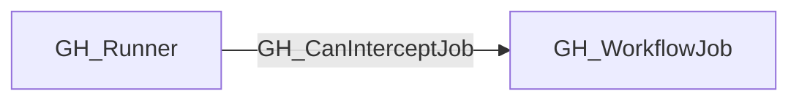

## Edge Schema

- Traversable: ✅

| Source | Destination |
| --- | --- |
| [GH_Runner](/opengraph/extensions/github/nodes/gh_runner) | [GH_WorkflowJob](/opengraph/extensions/github/nodes/gh_workflowjob) |

## General Information

The traversable GH_CanInterceptJob edge represents that a self-hosted runner not explicitly marked ephemeral can intercept a GitHub Actions workflow job that GitHub could schedule on it.

This edge is derived from [GH_RunsOn](/opengraph/extensions/github/edges/gh_runson) and is intended for attack-path analysis. It does not mean that the job has historically executed on the runner. It means that control of the runner may expose the future execution context of the job when the runner is not ephemeral.

The collector does not emit this edge for runners GitHub explicitly marks as ephemeral.

## Diagram



## Abuse Info

An attacker who already controls the persistent self-hosted runner host may inspect an eligible job's execution context when GitHub schedules it there. The GitHub API does not provide host compromise; that is a separate prerequisite.

Abuse using GitHub UI:

Open the controlled workflow run's job and compare its runner with the runner inventory. Host inspection must use the source host's own management/EDR tooling; GitHub metadata cannot replace that evidence.

Abuse using API:

1. Authenticate in the source context and set the exact destination identifiers. These examples require Bash, curl and jq. URL-encode path values that contain reserved characters. Use the configured server API root for GitHub Enterprise Server.

```bash
set -euo pipefail
export GITHUB_API="https://api.github.com"
export GITHUB_TOKEN="REPLACE_WITH_AUTHORIZED_TOKEN"
export OWNER="controlled-org"
export REPO="controlled-repo"
export RUN_ID="1"
export JOB_ID="1"
api() {
  curl --fail-with-body -sS \
    -H "Authorization: Bearer $GITHUB_TOKEN" \
    -H "Accept: application/vnd.github+json" \
    -H "X-GitHub-Api-Version: 2022-11-28" \
    "$GITHUB_API$1"
}
```

2. Check the source grant or execution context. Successful JSON reads return HTTP 200; authorization failures do not validate the path.

```bash
api "/repos/$OWNER/$REPO/actions/runs/$RUN_ID/jobs?per_page=100" | jq '.jobs[]|{id,name,runner_id,runner_name,runner_group_id,status}'
```

3. Verify the destination or adjacent control, then interpret the result within the edge's scope. Paginated listings require following all pages when used for complete coverage.

```bash
api "/repos/$OWNER/$REPO/actions/jobs/$JOB_ID" | jq '{id,name,runner_id,status,conclusion}'
```

Match the job's runner ID to the controlled host and inspect runner isolation locally through the authorized host session. Static selector matches and a non-ephemeral flag predict possible scheduling, not an observed execution. A job on another runner does not validate interception.

## Opsec Considerations

Correlate job/run IDs with runner diagnostics, host process/file telemetry and outbound connections. Secret masking does not protect a compromised host. These verification requests do not install an interceptor.

## References

- [Workflow jobs API](https://docs.github.com/en/rest/actions/workflow-jobs)
- [Self-hosted runners API](https://docs.github.com/en/rest/actions/self-hosted-runners)
- [Secure use of GitHub Actions](https://docs.github.com/en/actions/reference/security/secure-use)
