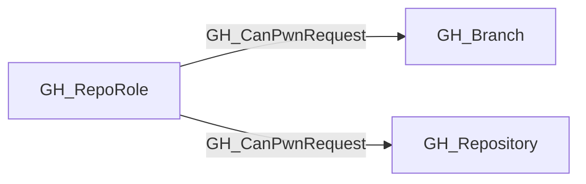

## Edge Schema

- Traversable: ✅

| Source | Destination |
| --- | --- |
| [GH_RepoRole](/opengraph/extensions/github/nodes/gh_reporole) | [GH_Branch](/opengraph/extensions/github/nodes/gh_branch) |
| [GH_RepoRole](/opengraph/extensions/github/nodes/gh_reporole) | [GH_Repository](/opengraph/extensions/github/nodes/gh_repository) |

## General Information

The traversable GH_CanPwnRequest edge identifies a repository role with a candidate pwn-request path through the detected workflow trigger and checkout pattern. Actual code execution, secret access and OIDC use depend on the consuming steps, effective run permissions and protection gates. This is a computed edge that combines workflow analysis with repository access and fork policy evaluation.

### Pwn Request Conditions

A workflow is considered pwn-requestable (`is_pwn_requestable = true`) when **all** of the following are true:

1. **`pull_request_target` trigger**: The workflow is triggered by `pull_request_target`, which runs in the context of the base branch (not the fork) and has access to the base branch's secrets and permissions.
2. **Attacker-controlled checkout**: A step uses `actions/checkout` with a `ref` parameter pointing to the pull request head, meaning attacker-supplied code from the fork replaces the trusted repository contents. Detected ref patterns:
   - `${{ github.event.pull_request.head.sha }}`
   - `${{ github.event.pull_request.head.ref }}`
   - `${{ github.head_ref }}`

### Edge Drawing Conditions

An edge is drawn from a [GH_RepoRole](/opengraph/extensions/github/nodes/gh_reporole) to the repository (and its branches) when:

1. **Read access**: The role has a [GH_ReadRepoContents](/opengraph/extensions/github/edges/gh_readrepocontents) edge to the repository (read access is the minimum required to fork).
2. **Forkability**: The repository can be forked by the role holder:
   - **Public repos**: Always forkable by anyone on GitHub.
   - **Private/internal repos**: Requires both the organization setting `members_can_fork_private_repositories = true` AND the repository setting `allow_forking = true`.
3. **Pwn-requestable workflow**: The repository has at least one workflow with `is_pwn_requestable = true`.

### Branch Targeting

- If the `pull_request_target` trigger has a `branches:` filter (e.g., `branches: [main]`), edges are drawn only to matching branches and the repository.
- If unconstrained, edges are drawn to the repository and all of its branches.

### Attack Impact

An attacker who exploits a pwn request gains code execution in the workflow runner with access to:

- **Repository secrets** scoped to the base branch
- **Organization secrets** accessible by the repository
- **GITHUB_TOKEN** with the workflow's declared permissions (often `write`)
- **OIDC tokens** if `id-token: write` is set, enabling cloud identity assumption via [GH_CanAssumeIdentity](/opengraph/extensions/github/edges/gh_canassumeidentity)
- **Environment secrets** if the workflow job targets a deployment environment

### Caveats

- **OIDC traversal requires `id-token: write`**: The attack chain from GH_CanPwnRequest through [GH_CanAssumeIdentity](/opengraph/extensions/github/edges/gh_canassumeidentity) to a cloud role is only valid if the pwn-requestable job's calculated `effective_github_token_permissions` includes `id-token:write`. The `id-token` permission defaults to `none` and is never implicitly granted — even when the workflow has no `permissions:` block at all. Inspect `workflow_permissions` on [GH_Workflow](/opengraph/extensions/github/nodes/gh_workflow), `job_permissions` on [GH_WorkflowJob](/opengraph/extensions/github/nodes/gh_workflowjob), and the job's `effective_github_token_permissions` to understand how the effective value was derived.
- **GITHUB_TOKEN permissions**: The `permissions:` block controls what the `GITHUB_TOKEN` can do (e.g., push commits, create releases), but has no effect on secret access, OIDC token requests (governed separately by `id-token`), or arbitrary code execution. A workflow with `contents: read` is still fully exploitable via pwn request for secret exfiltration and lateral movement — only write-back to the repository is limited.

## Diagram



## Abuse Info

A principal able to submit an eligible pull request can influence a pull_request_target job that checks out and executes untrusted head content. The collector's static checkout pattern is a risk indicator: checkout without later attacker-controlled execution is not sufficient proof of exploitation.

Abuse using GitHub UI:

Review the workflow and pull request Files changed, then the matching Actions run. Compare trigger and checkout ref with the run's actual event rather than assuming every pull_request_target workflow is vulnerable.

Abuse using API:

1. Authenticate in the source context and set the exact destination identifiers. These examples require Bash, curl and jq. URL-encode path values that contain reserved characters. Use the configured server API root for GitHub Enterprise Server.

```bash
set -euo pipefail
export GITHUB_API="https://api.github.com"
export GITHUB_TOKEN="REPLACE_WITH_AUTHORIZED_TOKEN"
export OWNER="controlled-org"
export REPO="controlled-repo"
export WORKFLOW_FILE="controlled.yml"
export BRANCH="main"
export RUN_ID="1"
api() {
  curl --fail-with-body -sS \
    -H "Authorization: Bearer $GITHUB_TOKEN" \
    -H "Accept: application/vnd.github+json" \
    -H "X-GitHub-Api-Version: 2022-11-28" \
    "$GITHUB_API$1"
}
```

2. Check the source grant or execution context. Successful JSON reads return HTTP 200; authorization failures do not validate the path.

```bash
api "/repos/$OWNER/$REPO/contents/.github/workflows/$WORKFLOW_FILE?ref=$BRANCH" | jq '{path,sha,encoding,content}'
```

3. Verify the destination or adjacent control, then interpret the result within the edge's scope. Paginated listings require following all pages when used for complete coverage.

```bash
api "/repos/$OWNER/$REPO/actions/runs/$RUN_ID" | jq '{id,event,head_branch,status,conclusion}'
```

Inspect the decoded workflow for an attacker-head checkout followed by execution of attacker-controlled code. Confirm forkability, branch filters and approvals. Use a dedicated canary-only pull request for any execution test and correlate its exact run/job; these reads alone do not prove execution. Environment secrets require their own gates and OIDC requires effective id-token:write.

## Opsec Considerations

Pull request events, workflow logs, commits and runner telemetry provide the trail. Secret masking does not make exfiltration safe, so use a non-sensitive marker instead of live credentials.

## References

- [Secure use of GitHub Actions](https://docs.github.com/en/actions/reference/security/secure-use)
- [Repository contents API](https://docs.github.com/en/rest/repos/contents)
- [Workflow runs API](https://docs.github.com/en/rest/actions/workflow-runs)
