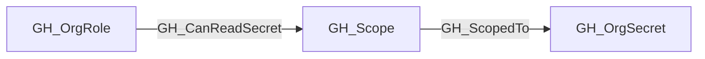

## Edge Schema

- Traversable: ✅

| Source | Destination |
| --- | --- |
| [GH_OrgRole](/opengraph/extensions/github/nodes/gh_orgrole) | [GH_OrgSecret](/opengraph/extensions/github/nodes/gh_orgsecret) |
| [GH_OrgRole](/opengraph/extensions/github/nodes/gh_orgrole) | [GH_Scope](/opengraph/extensions/github/nodes/gh_scope) |

## General Information

Org role can read organization secrets by creating a repository in the matching organization-secret scope. The collector emits this relationship from the role to a reusable [`GH_Scope`](/opengraph/extensions/github/nodes/gh_scope); [`GH_ScopedTo`](/opengraph/extensions/github/edges/gh_scopedto) expands the scope to its `all` or `private_or_internal` organization secrets. Selected secrets do not receive this derived capability because creating a repository does not add that repository to an arbitrary selected set.

## Diagram



## Abuse Info

A source organization role can reach organization secrets made available to a newly creatable repository visibility. The current emitter targets an organization-secret [GH_Scope](/opengraph/extensions/github/nodes/gh_scope) and expands it through [GH_ScopedTo](/opengraph/extensions/github/edges/gh_scopedto). It does not make selected-repository secrets available to every new repository.

Abuse using GitHub UI:

Inspect organization Settings > Secrets and variables > Actions and repository-creation policy. Confirm all/private availability and workflow execution rights before a canary test.

Abuse using API:

1. Authenticate in the source context and set the exact destination identifiers. These examples require Bash, curl and jq. URL-encode path values that contain reserved characters. Use the configured server API root for GitHub Enterprise Server.

```bash
set -euo pipefail
export GITHUB_API="https://api.github.com"
export GITHUB_TOKEN="REPLACE_WITH_AUTHORIZED_TOKEN"
export OWNER="controlled-org"
export REPO="controlled-repo"
export SECRET_NAME="CONTROLLED_CANARY"
api() {
  curl --fail-with-body -sS \
    -H "Authorization: Bearer $GITHUB_TOKEN" \
    -H "Accept: application/vnd.github+json" \
    -H "X-GitHub-Api-Version: 2022-11-28" \
    "$GITHUB_API$1"
}
```

2. Check the source grant or execution context. Successful JSON reads return HTTP 200; authorization failures do not validate the path.

```bash
api "/orgs/$OWNER/actions/secrets/$SECRET_NAME" | jq '{name,visibility,selected_repositories_url}'
```

3. Verify the destination or adjacent control, then interpret the result within the edge's scope. Paginated listings require following all pages when used for complete coverage.

```bash
api "/repos/$OWNER/$REPO" | jq '{full_name,visibility,permissions}'
```

Check secret visibility against the role's allowed repository-creation visibility. Actual plaintext access requires executing an authorized workflow in an eligible repository; the secrets API cannot download the value. Use a non-sensitive canary and verify an intended comparison result rather than printing a real secret.

## Opsec Considerations

Repository creation, workflow commits and run history record the execution path. Secret metadata reads are separate from consumption. Real secret exposure requires owner-coordinated rotation.

## References

- [Actions secrets API](https://docs.github.com/en/rest/actions/secrets)
- [Organization roles](https://docs.github.com/en/organizations/managing-peoples-access-to-your-organization-with-roles/roles-in-an-organization)
- [Secure use of GitHub Actions](https://docs.github.com/en/actions/reference/security/secure-use)
