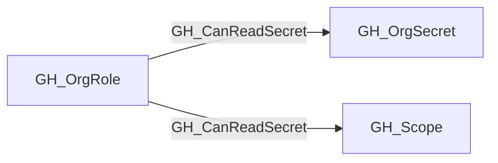
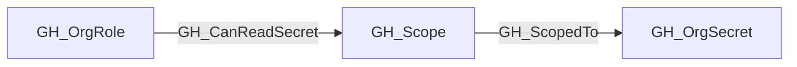

## Edge Schema

- Traversable: ✅

| Start | Kind | End |
|-------|-----------|-------|
| [GH_OrgRole](/opengraph/extensions/github/nodes/gh_orgrole) | GH_CanReadSecret | [GH_OrgSecret](/opengraph/extensions/github/nodes/gh_orgsecret) |
| [GH_OrgRole](/opengraph/extensions/github/nodes/gh_orgrole) | GH_CanReadSecret | [GH_Scope](/opengraph/extensions/github/nodes/gh_scope) |

## General Information

Org role can read organization secrets by creating a repository in the matching organization-secret scope. The collector emits this relationship from the role to a reusable [GH_Scope](/opengraph/extensions/github/nodes/gh_scope); [GH_ScopedTo](/opengraph/extensions/github/edges/gh_scopedto) expands the scope to its `all` or `private_or_internal` organization secrets. Selected secrets do not receive this derived capability because creating a repository does not add that repository to an arbitrary selected set.

## Edge Schema

| Source | Destination | Traversable |
| --- | --- | --- |
| [GH_OrgRole](/opengraph/extensions/github/nodes/gh_orgrole) | [GH_OrgSecret](/opengraph/extensions/github/nodes/gh_orgsecret) | `true` |
| [GH_OrgRole](/opengraph/extensions/github/nodes/gh_orgrole) | [GH_Scope](/opengraph/extensions/github/nodes/gh_scope) | `true` |

[GH_OrgRole](/opengraph/extensions/github/nodes/gh_orgrole) to [GH_OrgSecret](/opengraph/extensions/github/nodes/gh_orgsecret) remains an accepted legacy schema endpoint. Current OpenHound collections emit [GH_OrgRole](/opengraph/extensions/github/nodes/gh_orgrole) to [GH_Scope](/opengraph/extensions/github/nodes/gh_scope) instead.

## Diagram

