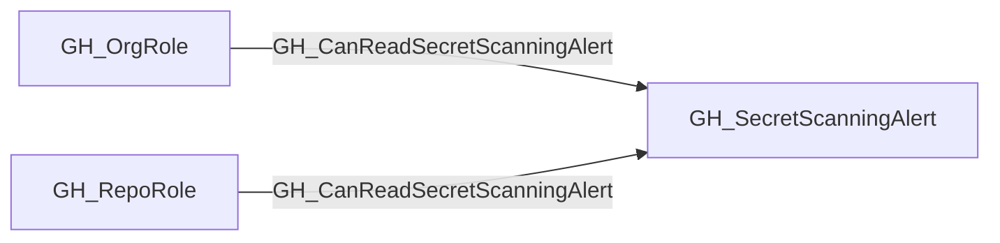

## Edge Schema

- Traversable: ✅

| Source | Destination |
| --- | --- |
| [GH_OrgRole](/opengraph/extensions/github/nodes/gh_orgrole) | [GH_SecretScanningAlert](/opengraph/extensions/github/nodes/gh_secretscanningalert) |
| [GH_RepoRole](/opengraph/extensions/github/nodes/gh_reporole) | [GH_SecretScanningAlert](/opengraph/extensions/github/nodes/gh_secretscanningalert) |

## General Information

The traversable GH_CanReadSecretScanningAlert edge is a computed edge indicating that a role can read a specific secret scanning alert, including the leaked secret value. The computation cross-references [GH_ViewSecretScanningAlerts](/opengraph/extensions/github/edges/gh_viewsecretscanningalerts) permission edges with [GH_Contains](/opengraph/extensions/github/edges/gh_contains) structural edges (org-level and repo-level) to determine which alerts each role can access. This edge is traversable because reading an alert reveals the leaked secret — if the secret is a valid GitHub Personal Access Token, the [GH_ValidToken](/opengraph/extensions/github/edges/gh_validtoken) edge enables identity compromise of the token's owner.

Each edge includes a `reason` property (`org_role_permission` or `repo_role_permission`) and a `query_composition` Cypher query showing the underlying graph evidence.

## Scenarios

### `org_role_permission` — Org role views alerts via organization

An org role with [GH_ViewSecretScanningAlerts](/opengraph/extensions/github/edges/gh_viewsecretscanningalerts) to the organization can read all secret scanning alerts across the entire org. The computation follows [GH_Contains](/opengraph/extensions/github/edges/gh_contains) edges from the organization to each alert.

## Diagram



## Abuse Info

A principal holding the source role can read supported secret-scanning alert data for the destination alert. Treat any returned credential as sensitive and distinguish an alert read from confirmation that the credential still works.

Abuse using GitHub UI:

Open the repository Security secret-scanning alert and its locations as the controlled role holder. Check state and validity before considering any credential-use test.

Abuse using API:

1. Authenticate in the source context and set the exact destination identifiers. These examples require Bash, curl and jq. URL-encode path values that contain reserved characters. Use the configured server API root for GitHub Enterprise Server.

```bash
set -euo pipefail
export GITHUB_API="https://api.github.com"
export GITHUB_TOKEN="REPLACE_WITH_AUTHORIZED_TOKEN"
export OWNER="controlled-org"
export REPO="controlled-repo"
export ALERT_NUMBER="1"
api() {
  curl --fail-with-body -sS \
    -H "Authorization: Bearer $GITHUB_TOKEN" \
    -H "Accept: application/vnd.github+json" \
    -H "X-GitHub-Api-Version: 2022-11-28" \
    "$GITHUB_API$1"
}
```

2. Check the source grant or execution context. Successful JSON reads return HTTP 200; authorization failures do not validate the path.

```bash
api "/repos/$OWNER/$REPO/secret-scanning/alerts/$ALERT_NUMBER" | jq '{number,state,secret_type,validity}'
```

3. Verify the destination or adjacent control, then interpret the result within the edge's scope. Paginated listings require following all pages when used for complete coverage.

```bash
api "/repos/$OWNER/$REPO/secret-scanning/alerts/$ALERT_NUMBER/locations?per_page=100" | jq 'map({type,details})'
```

Expect HTTP 200 for both permitted reads. The examples intentionally select alert metadata rather than print secret values. If a supported token is resolved to a user during preprocessing, [GH_ValidToken](/opengraph/extensions/github/edges/gh_validtoken) expresses the separate authentication path. Resolve or rotate an exposed credential through its owner rather than assuming closing the alert revokes it.

## Opsec Considerations

Secret-scanning APIs and alert changes may be captured in organization audit/API telemetry according to plan and configuration. Reading an alert need not generate the same audit event as resolving it. Never copy raw credentials into run logs or reports.

## References

- [Secret scanning API](https://docs.github.com/en/rest/secret-scanning/secret-scanning)
- [Organization audit log](https://docs.github.com/en/organizations/keeping-your-organization-secure/managing-security-settings-for-your-organization/reviewing-the-audit-log-for-your-organization)
