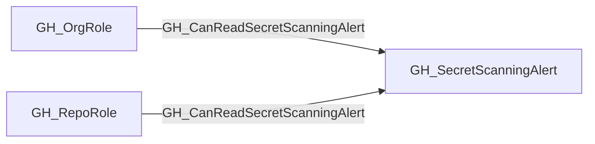

## Edge Schema

- Traversable: ✅

| Source | Destination |
| --- | --- |
| [GH_OrgRole](/opengraph/extensions/github/nodes/gh_orgrole) | [GH_SecretScanningAlert](/opengraph/extensions/github/nodes/gh_secretscanningalert) |
| [GH_RepoRole](/opengraph/extensions/github/nodes/gh_reporole) | [GH_SecretScanningAlert](/opengraph/extensions/github/nodes/gh_secretscanningalert) |

## General Information

The traversable GH_CanReadSecretScanningAlert edge is a computed edge indicating that a role can read a specific secret scanning alert, including the leaked secret value. The computation cross-references [GH_ViewSecretScanningAlerts](/opengraph/extensions/github/edges/gh_viewsecretscanningalerts) permission edges with [GH_Contains](/opengraph/extensions/github/edges/gh_contains) structural edges (org-level and repo-level) to determine which alerts each role can access. This edge is traversable because reading an alert reveals the leaked secret — if the secret is a valid GitHub Personal Access Token, the [GH_ValidToken](/opengraph/extensions/github/edges/gh_validtoken) edge enables identity compromise of the token's owner.

Each edge includes a `reason` property (`org_role_permission` or `repo_role_permission`) and a `query_composition` Cypher query showing the underlying graph evidence.

## Scenarios

### `org_role_permission` — Org role views alerts via organization

An org role with [GH_ViewSecretScanningAlerts](/opengraph/extensions/github/edges/gh_viewsecretscanningalerts) to the organization can read all secret scanning alerts across the entire org. The computation follows [GH_Contains](/opengraph/extensions/github/edges/gh_contains) edges from the organization to each alert.

## Diagram

