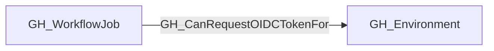

## Edge Schema

- Traversable: ✅

| Source | Destination |
| --- | --- |
| [GH_WorkflowJob](/opengraph/extensions/github/nodes/gh_workflowjob) | [GH_Environment](/opengraph/extensions/github/nodes/gh_environment) |

## General Information

The traversable GH_CanRequestOIDCTokenFor edge represents a static upper-bound capability: based on the collected workflow configuration, a GitHub Actions workflow job execution context may be able to request a GitHub-signed OIDC token containing claims for its associated GitHub Environment.

This edge is derived from the existing [GH_DeploysTo](/opengraph/extensions/github/edges/gh_deploysto) relationship and the job's calculated `effective_github_token_permissions`. The collector emits it only when the job targets a statically resolved environment and its effective permissions include `id-token:write`.

This is a capability edge, not evidence that the workflow has historically requested a token or contains an explicit OIDC-related step. Code executing in a job with `id-token:write` can request the token directly.

The edge does not model run-specific permission recalculation. In particular, a `pull_request` run originating from a fork may receive downgraded `GITHUB_TOKEN` permissions at runtime and therefore may not be able to request an OIDC token even when this edge exists. The edge should not be interpreted as proof that every execution of the job can request OIDC.

## Diagram



## Abuse Info

Code executing in the source job may request a GitHub OIDC token carrying its environment context when effective runtime permissions include id-token: write. Environment gates and event-specific permission downgrades still apply; this edge alone does not prove a cloud provider accepts the token.

Abuse using GitHub UI:

Inspect the workflow/job permissions block and the run's environment approval. Distinguish a static id-token permission from a successful token request in that particular event context.

Abuse using API:

1. Authenticate in the source context and set the exact destination identifiers. These examples require Bash, curl and jq. URL-encode path values that contain reserved characters. Use the configured server API root for GitHub Enterprise Server.

```bash
set -euo pipefail
export GITHUB_API="https://api.github.com"
export GITHUB_TOKEN="REPLACE_WITH_AUTHORIZED_TOKEN"
export OWNER="controlled-org"
export REPO="controlled-repo"
export JOB_ID="1"
export ENVIRONMENT="controlled-canary"
api() {
  curl --fail-with-body -sS \
    -H "Authorization: Bearer $GITHUB_TOKEN" \
    -H "Accept: application/vnd.github+json" \
    -H "X-GitHub-Api-Version: 2022-11-28" \
    "$GITHUB_API$1"
}
```

2. Check the source grant or execution context. Successful JSON reads return HTTP 200; authorization failures do not validate the path.

```bash
api "/repos/$OWNER/$REPO/actions/jobs/$JOB_ID" | jq '{id,name,run_id,status,conclusion}'
```

3. Verify the destination or adjacent control, then interpret the result within the edge's scope. Paginated listings require following all pages when used for complete coverage.

```bash
api "/repos/$OWNER/$REPO/environments/$ENVIRONMENT" | jq '{id,name,protection_rules}'
```

The requests verify job and environment metadata. Within an authorized Actions job, request the OIDC token through the runner-provided request URL/token using the intended audience; never print it. Verify issuer, audience, subject and expiration before any downstream exchange. An external workstation cannot use this REST metadata API to mint a workflow OIDC token.

## Opsec Considerations

Workflow/deployment history records job execution; downstream cloud sign-in/audit logs record token exchanges. GitHub metadata alone is not evidence of cloud authentication.

## References

- [OpenID Connect in GitHub Actions](https://docs.github.com/en/actions/concepts/security/openid-connect)
- [Deployment environments API](https://docs.github.com/en/rest/deployments/environments)
- [Workflow jobs API](https://docs.github.com/en/rest/actions/workflow-jobs)
